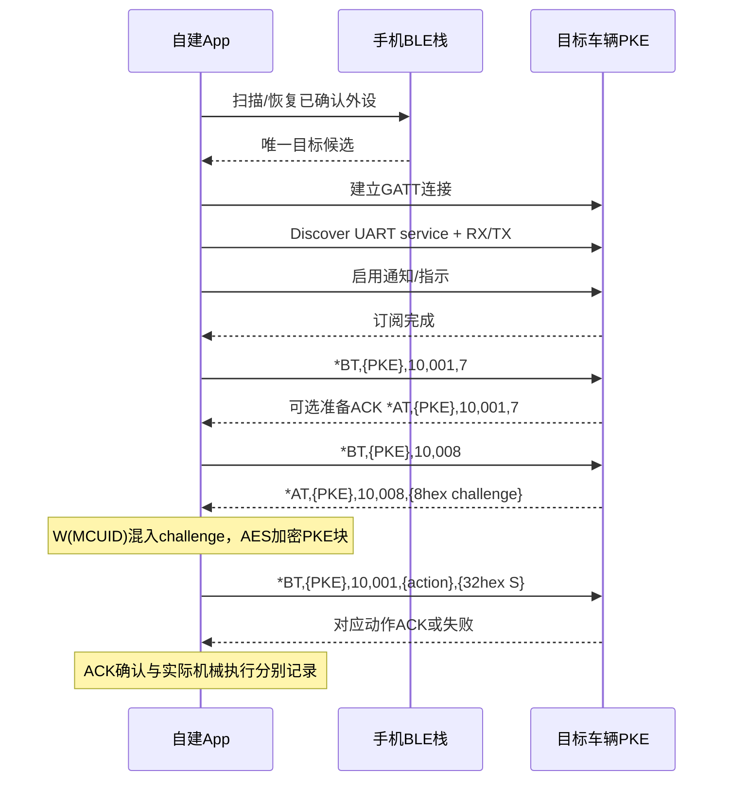
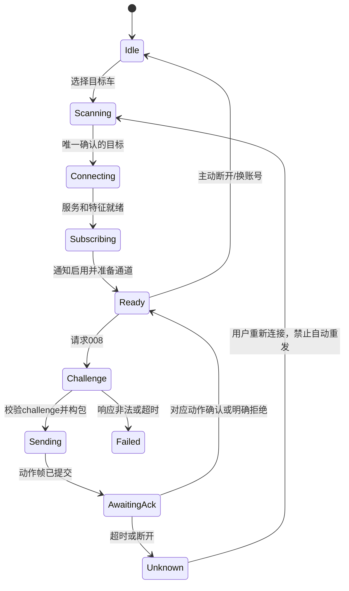

# 蓝牙控车协议：发现、GATT、认证、动作与参数设置

版本：1.0 · 核对日期：2026-10-30。

本文说明手机与车辆 PKE 的近场 BLE 控制。需要的官方登录和车辆字段来源见[远端控车协议](远端控车协议.md)。两条控车通道分别实现：蓝牙动作不经过 `www.sharpon.com:4510`，也不使用远程报文的外层 RSA。

## 1. 已知范围和验证程度

证据来自 ShiRide 1.2.25 / 1.3.0 的 `O8.q1` 原始 ARM64、1.3.0 的 GATT/设置调用，以及 ZontesRide iOS 的 packet builder、BLE service 和测试。

本次生成 **96组不同输入**，分别运行两个版本的 Native q1，共192次报文比较，与本仓库独立实现一致。覆盖上锁、解锁、油箱盖、坐垫，大小写hex challenge、随机MCUID，以及15/16/64字节PKECode边界。不是连接实车测试；五字段 ACK 的识别来自客户端代码，不是所有车型均已抓包确认。

| 内容 | 状态 |
|---|---|
| BLE服务/特征UUID、准备帧、challenge请求 | 代码确认 |
| 白盒 + challenge + AES动作报文 | 两版本Native确认 |
| 动作1/2/5/6 | APK枚举和Native确认；现有iOS界面仅暴露5/6 |
| 设置和RGB指令 | APK调用与解析代码确认，未实车写入 |
| 广播设备匹配 | 客户端启发式，不是密码学身份证明 |
| SMP配对、链路层加密要求 | 本次未确认，不应推断为必须/不需要 |
| 其他厂商固件、不同PKE代际兼容 | 待实测 |

## 2. 实现需要保存什么

| 数据 | 来源 | 作用 |
|---|---|---|
| 目标PKECode | 自己账号的官方车辆列表 | 所有`*BT`帧的目标字段 |
| 对应MCUID | 同一车辆资料，32 hex | 蓝牙认证密钥派生材料 |
| 已确认设备标识 | 用户首次选择/验证后保存 | 后续连接同一辆车 |
| challenge | 本次连接上向车辆查询得到 | 每次认证用的4字节变化量 |
| 白盒表 | 本仓库配套资源 | 固定16字节变换W |
| 会话/授权快照 | App自己的登录/车辆模型 | 切账号、切车、过期时取消旧操作 |

不能把蓝牙名称、MAC、VIN、车牌、手机号当作MCUID；不能把另一台车的MCUID和当前PKECode拼在一起。MCUID虽然出现在登录后的资料里，仍属于车辆认证材料，不能公开发布真实值。

编码本身不需要 HTTP Token、密码、UserCode、时钟、手机 deviceID 或 RSA 公钥；但材料的合法来源和账号/授权状态由 App 管理。只缓存了车辆资料不等于重新验证过授权。离线使用策略与服务端撤销即时性需要开发者明确设计。

## 3. GATT 服务和特征

使用 Bluetooth Low Energy GATT，UUID与Nordic UART形式相同，但不能因此将业务报文视为标准Nordic协议。

| 名称 | UUID | 方向/用途 |
|---|---|---|
| 服务 | `6E400001-B5A3-F393-E0A9-E50E24DCCA9E` | 车辆UART服务 |
| Write/RX | `6E400002-B5A3-F393-E0A9-E50E24DCCA9E` | 手机写入车辆 |
| Notify/TX | `6E400003-B5A3-F393-E0A9-E50E24DCCA9E` | 车辆回手机 |
| CCCD | `00002902-0000-1000-8000-00805F9B34FB` | Android启用通知/指示 |

连接成功之后：发现服务→发现两个特征→检查属性→订阅通知→等待订阅完成→准备通道→开始challenge流程。`didConnect/onConnectionStateChange`只表示链路连接，不表示业务可控制。

Write特征检查属性bit：`0x08`支持Write with response，`0x04`支持Write without response。已有实现优先with response。Notify特征检查 `0x10` notification、`0x20` indication。CCCD启用值分别是 `01 00` / `02 00`（小端16位bitmask）；不要把它误写成ASCII字符串`"0100"`。

Android除 `setCharacteristicNotification(true)` 外，还要写CCCD并等回调；iOS通过 `setNotifyValue(true, for:)` 管理，等 `isNotifying=true`。两个条件不足时不应进入ready。

## 4. 设备发现和目标绑定

### 4.1 观察到的广播匹配

APK会先复用当前车辆已经确认的设备地址；没有目标时扫描，再做唯一匹配：

1. 把PKECode标准化为ASCII字母/数字大写。
2. 优先用广播/厂商数据候选与完整标准化PKE匹配，代码兼容PKE文本、尾部`0`、PKE的ASCII hex表示。
3. 在没有相关厂商数据时，兼容设备名标准化后恰等于 `PKE` + PKE末4位。
4. 只在一个候选唯一匹配时自动选中；多个候选或无法确认则交给用户选择。

广播厂商数据的公司ID、完整二进制布局和不同硬件代际规则没有在本次确认，不应发明固定偏移。后续拿到广告原始字节时应补充合成/脱敏样例。

现有iOS实现更宽松：看到UART服务、名称含PKE末4/6/8位，或名称前缀 `PKE/ZONTES/SHIRIDE/SHARPON` 就可能选中。**这只是候选发现逻辑，不足以证明是目标车。** 新App应展示候选、处理多车歧义，并在业务回包核对PKE。

### 4.2 保存规则

以账号身份+车辆稳定ID+PKECode关联已确认设备。iOS保存 `CBPeripheral.identifier`，Android可保存当时看到的设备地址；不能承诺两平台标识相同，也不能承诺BLE地址永久不变。

切车/换账号/重新绑定/蓝牙关闭时递增连接generation。旧连接回调、旧challenge、未完成ACK和重连定时器全部失效，不能把旧设备的结果写到新车辆上。

扫描可以先过滤服务，但有些广播未携带服务UUID。已有iOS使用全量扫描再筛选；不要只因服务过滤扫描为空就认定附近没有车。发现能力、操作系统权限和已绑定设备检索要分开处理。

## 5. 连接和动作完整时序



challenge响应也兼容 `*BT` 前缀。图中带PKE的ACK是合成格式示例；客户端解析代码没有证明所有固件都校验或回显目标字段。不可把示例当作实车抓包。

## 6. 文本帧格式与全部基础指令

业务帧采用ASCII；`*`开头，`,`分隔，`#`结尾。不带CRLF、不做Base64/hex编码，也不附加校验和、二进制长度头或NUL。

| 指令 | 原始文本 | 作用 |
|---|---|---|
| 准备通道 | `*BT,{PKE},10,001,7#` | prime/ready，不是动作7的加密控制 |
| 请求challenge | `*BT,{PKE},10,008#` | 查询本次4字节安全响应 |
| 认证动作 | `*BT,{PKE},10,001,{A},{S}#` | A=1/2/5/6，S=32位大写hex |

`10`是固定协议字段，当前未证明其业务含义；`001/008`是操作选择符，必须保留前导0。不要把 `008` 解析成8后丢失原始字符串。

### 6.1 准备帧

```text
手机：*BT,PKE123,10,001,7#
车辆：*AT,PKE123,10,001,7#    （说明性ACK样例）
```

APK等待准备ACK约1200ms，未收到仍继续尝试challenge。现有iOS在订阅完成后发送准备帧，也不把准备ACK作为强制条件。动作号7在此没有S字段，不能拿去调用加密q1，也不能把它解释成锁/解锁成功。

### 6.2 请求和读取challenge

```text
手机：*BT,PKE123,10,008#
车辆：*AT,PKE123,10,008,12345678#
```

拆去`#`后，按从0开始编号：

| 索引 | 期望 |
|---:|---|
| 0 | `*AT`，兼容`*BT` |
| 1 | 目标身份字段；新实现优先核对选中PKE |
| 2 | `10` |
| 3 | `008` |
| 4 | 恰好8个hex字符，解码4字节 |

challenge **允许A..F**，不是远程的8位十进制随机串。`89ABCDEF`合法；`1234567`、`123456789`、`GGGGGGGG`非法。不要把它解释为文本密码、十进制整数或“车机公钥”。

每次动作查询新的challenge，不能跨外设、跨重连或多条并发动作共享。服务端/车辆是否一次性消费、有效时长与重放窗口尚未知。

### 6.3 认证动作表

| A | APK枚举 | 作用 | Native q1支持 | 现有iOS UI |
|---|---|---|---|---|
| `1` | LOCK | 上锁 | 是 | 未暴露在附件动作枚举 |
| `2` | UNLOCK | 解锁 | 是 | 未暴露在附件动作枚举 |
| `5` | FUEL_LID | 打开油箱盖 | 是 | 是 |
| `6` | SEAT | 打开坐垫 | 是 | 是 |

Native q1拒绝0、3、4、7、8、9、10和非数字动作，本次已离线核对。API层可以只暴露设备已验证支持的子集，不能由q1能生成报文就认定每台车都支持相应机械机构。

## 7. 认证算法：精确字节定义

### 7.1 输入校验与容易遗漏的截断

Native q1输入依次为 `MCUID,PKECode,challenge,action`：

| 字段 | Native行为 |
|---|---|
| MCUID | 32 hex字符，解码16字节 |
| PKECode | 1..64个可见ASCII，排除空格、逗号、`#` |
| challenge | 8 hex字符，解码4字节 |
| action | 只接受字符串1/2/5/6 |

**参与AES的PKE块只复制PKECode的前15个ASCII字节，余下补0至16字节。发送帧中的PKECode仍是完整值。**

```text
P = ASCII(PKECode)[0:15]，右补00到16字节
```

长度15时最后一字节为00；长度16..64时也只取前15字节。这由两个版本原始函数差分确认。现有Swift builder限制PKECode≤15，属于保守实现限制，不能误写成Native协议只接受15字节。独立App若支持长PKE，必须使用上述截断定义，不能直接AES加密前16字节。

### 7.2 密钥派生与AES

```text
M = hexDecode(MCUID)       16字节
C = hexDecode(challenge)    4字节
K = W(M)                  16字节
K[12+i] = K[12+i] XOR C[i]，i=0..3
S = upperHex(AES-128-ECB(key=K, block=P))
packet = ASCII("*BT,"+PKECode+",10,001,"+action+","+S+"#")
```

不使用IV、CBC、PKCS#7、MD5、HMAC、RSA，也不需要Unix时间。`S`恰好32个大写hex字符，表示16字节AES密文。

action不参与这里的AES输入。同一个MCUID、PKECode和challenge会为1/2/5/6生成相同S，但最终帧的action字段不同。这是Native输出事实，不表示可以省略challenge、变更授权或推断固件防重放策略。

帧总字节数为 `47+len(ASCII(PKECode))`，例如PKE123长6，动作帧长53字节；不是固定20字节BLE包。变化长度来源是PKECode，而签名长度固定。

### 7.3 白盒变换W

W是完整的16字节输入→16字节输出查表变换，表资源[在这里](../resources/c9x_tables.bin)，可运行算法为 [whitebox_block()](../examples/protocol.py)。没有要求运行Android SO，也不需要提取出一个裸固定AES密钥。

资源长度372736字节，SHA-256 `58234bb81e68933db3f244003817a622c7a866c332bec8b5d6164e128d887d07`。表分三段：偏移0长度0x24000为9轮四字节替换项，偏移0x24000长度0x36000为半字节合并表，偏移0x5a000长度0x1000为末轮替换表。

九轮的输入位置排列为 `[0,5,10,15,4,9,14,3,8,13,2,7,12,1,6,11]`；每列取4个word，再逐字节经6张半字节合并表合成。末轮按 `[0,13,10,7,4,1,14,11,8,5,2,15,12,9,6,3]` 写回。完整索引公式在另一文档第11.3节以及同仓库代码中，没有隐藏依赖。

白盒固定向量：

```text
W(00000000000000000000000000000000)=1d89f3053c90709c7822c874000dc8dc
W(000102030405060708090a0b0c0d0e0f)=c50bd33e0ff09b7021fb5cfb32b84ce6
```

### 7.4 完整动作向量

```text
MCUID    = 12345678901234567890123456789012
PKECode  = PKE123
challenge= 12345678
P        = 50 4B 45 31 32 33 00 00 00 00 00 00 00 00 00 00
S        = FCE57A2E8EF05D473A4A82317486BE36

上锁：*BT,PKE123,10,001,1,FCE57A2E8EF05D473A4A82317486BE36#
解锁：*BT,PKE123,10,001,2,FCE57A2E8EF05D473A4A82317486BE36#
油箱：*BT,PKE123,10,001,5,FCE57A2E8EF05D473A4A82317486BE36#
坐垫：*BT,PKE123,10,001,6,FCE57A2E8EF05D473A4A82317486BE36#
```

同MCUID/PKE，challenge改为`89ABCDEF`，S为`409777E819ACBBDFF1F9A9FBAD70E349`。完整96组ASCII与hex报文见 [bluetooth.json](../vectors/bluetooth.json)。均为虚构身份与离线测试，不得作为实际车辆输入复用。

## 8. 写入分片、排队和通知重组

### 8.1 MTU与写入

Android默认ATT MTU通常只能承载20字节有效负载；APK尝试请求MTU256，约等1000ms回调，失败继续使用现有MTU。Android实际写入方式与固件长写支持需实测；不能因一次调用提交53字节就认为所有BLE栈都帮你正确分片。

新实现以特征能力和系统给出的最大写入长度为准。Android通常按 `negotiatedMTU-3` 计算普通ATT有效负载；iOS用 `maximumWriteValueLength(for:)`，不要假定固定20或固定253。

发送完整帧的顺序字节流，按最大负载分片。帧片之间不添加额外 `*`、`#` 或片号。每条动作从请求challenge直到ACK仅允许一个进行，避免challenge错配。

withResponse模式逐片等待写回调再发下一片；withoutResponse模式遵守系统的可发送状态/拥塞回调，保持串行。现有iOS service用循环连续write，各平台新实现应补队列和背压。GATT写回调成功只代表写入层完成，不能代替业务ACK。

### 8.2 接收

Notify的一个回调可能是半帧、多帧、噪声+帧，甚至把challenge拆开。先累积bytes，找到`*`、再找到对应`#`后提取；未完成尾部留到下一次。非法嵌套起始符应重新同步，避免把两条帧拼成一条。

建议设有界接收缓冲。现有iOS超512字符时保留末256字符；新实现可更明确报告超限而非静默吞掉。ASCII协议先按字节分帧再解码，不依赖每个通知都是完整UTF-8字符串。

本仓库 `FrameBuffer` 可用于 `*...#` 业务帧；**AT+参数/RGB是另一种CRLF/关键字文本，不能用该解析器直接等待`#`。**

## 9. ACK、拒绝和结果未知

动作ACK兼容的最短形式：

```text
*AT,PKE123,10,001,6#      对应坐垫动作的五字段回显
*AT,PKE123,10,001,6,0#    带显式失败尾字段的合成示例
```

解析顺序：完整帧→类型`*AT`→目标/操作关联→动作号匹配→失败优先→确认。不能拿准备帧`action=7`、challenge帧`008`或另一个动作的ACK结束本次动作。

APK的`gea.a`按类型`*AT`、字段3=`001`、字段4等于期望动作判确认，`vk0.n`在前面还检查最后字段`0#`判失败；iOS也先看末尾`0`。因此不能将 `*AT,...,001,6,0#` 因“出现action6”误判成功。

原解析没有充分检查字段1/2是否目标PKE/`10`，且可能把额外尾字段当作无关值。新App应在明确的目标布局上增加关联检查；如果固件没有回显身份，使用当前连接+阶段+单操作队列约束，不虚构强关联能力。

本仓库保守示例确认五字段ACK，明确拒绝六字段尾0；六字段尾1或其他额外状态尚没有足够Native/抓包证据定义为通用成功码，因此保留为未识别。ACK不携带物理传感器结果时，“蓝牙已确认”不等于锁、油箱盖或坐垫一定完成机械运动。

一旦动作帧开始提交后发生超时/取消/断线，结果为unknown。重连可以恢复通道，但不得自动重发动作，也不得自动切到远程TCP再发同一动作。challenge查询在尚未提交动作前可有限重试，旧challenge作废。

## 10. 超时和连接状态机

| 阶段 | 已观察APK设置 | 现有iOS设置 |
|---|---:|---:|
| 扫描/准备连接 | 扫描约10秒，常规连接预算12秒 | 扫描到准备完成共12秒 |
| 服务发现 | 5秒 | 由整体连接预算覆盖 |
| MTU请求等待 | 1秒 | 系统管理 |
| 准备ACK | 1.2秒，可继续 | 不强制等待 |
| challenge等待 | 2.8秒 | 5秒 |
| 动作ACK等待 | 约3秒 | 5秒 |
| withResponse写回调 | 900ms后记录缺失并继续 | 回调错误终止，原实现未逐片排队 |
| withoutResponse间隔 | 一次写后约180ms | 原实现循环写 |
| 非主动断开重扫 | 按运行状态管理 | 延迟1秒 |

这些不是硬件协议保证。新App应配置总期限、采用单调时间、在后台/取消时清理定时器；将 `unavailable/poweredOff/idle/scanning/connecting/subscribing/ready/awaitingChallenge/sending/awaitingAck/failed` 分开。



连接准备成功可以复用同一外设，challenge仍需刷新。登录变化、目标变化和蓝牙重启应使缓存会话失效。不要让旧设备上的连接完成回调覆盖新目标状态。

## 11. 车辆参数设置 AT+ 通道

此部分同样走UART特征，但使用ASCII AT文本与CRLF终止；不是`*BT`加密动作格式。APK先准备/复用已经确认的目标通道，再发原始AT命令。代码未给这些AT文本再附q1签名，不能据此认定任意未认证连接都可写入；实际固件的会话权限要求待验证。

### 11.1 读取参数

```text
手机发送：AT+READ_PARAM\r\n
响应模板：READ_PARAM=5,{mode},{minutes},{ess},{seat},{handbrake}\r\n
合成例子：READ_PARAM=5,1,10,0,1,0\r\n
```

现有解析器找到`READ_PARAM`后的`=`，剔除CR/LF后按逗号拆分，至少6项；读取索引1..5。第0项在写入时固定5，含义与参数数量一致，但读取端没有强制验证它。新实现应校验类型/数量，保留未知附加字段以备版本兼容。

### 11.2 写入参数

```text
AT+SET_PARAM=5,{mode},{minutes},{ess},{seat},{handbrake}\r\n
```

| 索引（等号右侧，从0计） | 参数 | 客户端范围/语义 |
|---:|---|---|
| 0 | 参数数目字段 | 发送固定5 |
| 1 | keyDetectionMode | 0/1/2，见下 |
| 2 | powerOffTimeoutMinutes | 1..30，分钟 |
| 3 | essEmergencyBrakeAlarm | 0/1，ESS紧急刹车报警 |
| 4 | doubleClickSeatToOpen | 0/1，着车双击坐垫键开坐垫 |
| 5 | handbrakeAlarm | 0/1，手刹报警 |

mode=0：持续检测钥匙，钥匙离开即断电；mode=1：持续检测，离开只锁ECU，无操作超时后断电；mode=2：开机检测一次钥匙，无操作超时后断电。此语义来自APK设置模型和界面资源，不代表所有固件均实现。

写入确认关键字：`SET_PARAM_OK`；拒绝：`SET_PARAM_FAIL`。APK写入时将mode钳制0..2、minutes钳制1..30；示例代码选择拒绝非法值，便于调用者发现错误。界面预置1/3/5/10/15/20/30分钟只是UI选项，不是协议仅接受这7个值。

APK本地偏好默认mode1、10分钟、三个flag=false，这些是App默认值，不能写成车辆出厂值。最好先读取，再展示差异、按用户操作发送，并读取确认；读失败时不要把本地默认覆盖成“当前车辆设置”。

## 12. 氛围灯 AT+ 通道

```text
AT+SET_RGB={enabled},{red},{green},{blue}\r\n
```

enabled=0/1，RGB各0..255十进制。APK钳制色值至范围；无MCUID密文后缀。确认关键字`RGBOK`，失败关键字`RGBFAIL`。例：`AT+SET_RGB=1,0,137,95\r\n`为合成指令，未发往车辆。

并非所有车型有氛围灯。软件能构造该文本不等于目标车辆支持；未知指令、超时或返回空不应判“已应用”。

原始关键字可能跨通知边界，需要单独有界缓冲；同一个事务先检查失败关键字，再检查成功关键字，不能看到`READ_PARAM`或一个短字符串就提前认定完整响应。参数/RGB读写也应与动作共用串行GATT操作队列，避免交错。

## 13. 平台实现要点

### 13.1 Android

依据目标SDK管理扫描/连接所需权限，较旧系统的扫描还可能受定位权限/系统定位状态影响。扫描不可用与车不在附近要分别报告。连接使用BLE GATT，检查status/newState；服务、描述符、MTU、写特征等异步操作逐项排队，不依赖固定sleep。

断开后释放Gatt；避免同一外设多个活跃Gatt。使用当前连接对象与generation过滤晚到回调。临时唤醒锁或前台服务用于App生命周期管理，不是线上协议字段，也不是车辆认证条件。

### 13.2 iOS

使用CoreBluetooth，声明蓝牙用途描述，等待central poweredOn；连接外设、订阅和写入通常在同一队列管理。用户拒绝权限/关闭蓝牙时结束等待，不留悬挂continuation。

withResponse等待`didWriteValueFor`，withoutResponse遵守 `canSendWriteWithoutResponse` / `peripheralIsReady(toSendWriteWithoutResponse:)`。iOS外设UUID不是Android MAC；后台扫描、重连、进程被杀后的恢复不能仅由协议文档承诺。

### 13.3 自动靠近控车与远程后备

APK还有RSSI采样、缓存目标、自动控制运行时等逻辑；RSSI由手机BLE栈读取，不是本协议额外的车辆认证报文。距离/阈值/驻留时间、误触抑制属于App策略，不应由一次信号变强直接决定开锁。

选择BLE或TCP应在提交动作之前完成。BLE已提交但ACK丢失时不能自动远程补发；切通道会使同一用户操作执行两次。不同通道“可连接”“认证通过”“动作确认”“实际状态”要分别显示。

## 14. 可运行样例和移植验收

```sh
python3 -m venv .venv
.venv/bin/pip install -r requirements.txt
.venv/bin/python -m unittest discover -s tests -v
.venv/bin/python examples/verify.py
```

```python
import sys
sys.path.insert(0, "examples")
from protocol import bluetooth_command, FrameBuffer, bluetooth_challenge, bluetooth_ack

stream = FrameBuffer()
assert stream.feed(b"*AT,PKE123,10,008,1234") == []
frames = stream.feed(b"5678#")
challenge = bluetooth_challenge(frames[0], "PKE123")
packet = bluetooth_command(
    "6", "PKE123", "12345678901234567890123456789012", challenge
)
assert packet == b"*BT,PKE123,10,001,6,FCE57A2E8EF05D473A4A82317486BE36#"
assert bluetooth_ack("*AT,PKE123,10,001,6#", "PKE123", "6") == "confirmed"
assert bluetooth_ack("*AT,PKE123,10,001,6,0#", "PKE123", "6") == "rejected"
# 本例只在内存里构造/解析，没有扫描或连接车辆。
```

跨语言验证顺序：白盒SHA/向量→challenge hex解码→K末4字节XOR→PKE前15字节+NUL→AES ECB无padding→完整动作ASCII→按字节分片→通知重组→阶段/目标/action关联→错误和取消路径。

最少验收用例：通知逐字节到达、一次多帧、无关准备ACK、错误PKE、错误action、显式尾0、非法challenge、PKE长度15/16/64、withResponse失败、通知订阅失败、动作发送后断线、换车时旧回调到达、蓝牙关闭、重连后challenge作废。代码测试见 [test_protocol.py](../tests/test_protocol.py)，实际车辆测试应另行记录车型/固件/状态，不上传真实认证材料。

## 15. 仍待确认的细节

未确认：不同PKE硬件的广告数据布局、BLE地址变更、系统配对/链路加密要求、challenge有效期与消费规则、额外ACK状态字段、机械执行与ACK之间的时间关系、参数/RGB的全部固件兼容性、无网络时授权撤销的实际行为。

没有把这些空白填成“默认允许”或虚构字节。新增版本应提供脱敏报文与来源指纹，再扩展文档和测试向量。
