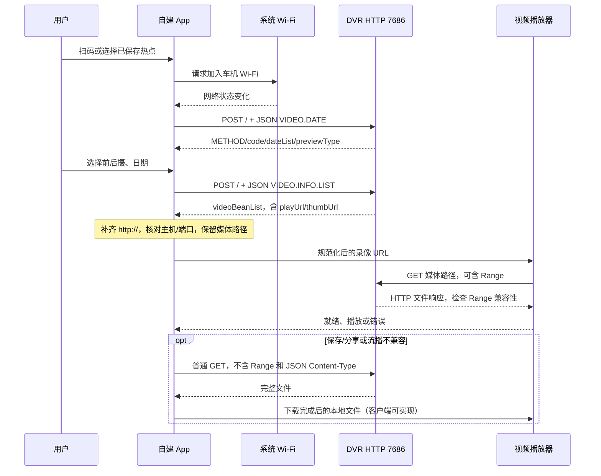

# 行车记录仪协议：连接、录像列表、播放与下载

版本：1.0 · 核对日期：2026-10-30 · 固件样本：`JC_703T25_V02.26.02.02.60`。

本文用于独立实现 Android / iOS / 桌面客户端的**录像回看和下载**。同仓库还有[远端控车协议](远端控车协议.md)和[蓝牙控车协议](蓝牙控车协议.md)。实时画面不属于本文实现范围，现有 iOS 工具已移除实时流及其端口探测。

## 1. 证据范围与完成程度

主要依据原始固件的 `usr/bin/DVR`、`etc/configl/config_dvr.ini`、`etc/hostapd.sh` 和 `etc/udhcpd.conf`，并对照 ZontesRide 的文件客户端、播放器与测试。程序 SHA-256、函数地址、配置事实和测试边界见[行车记录仪证据索引](../evidence/dashcam-verification.json)。本文不附带原始固件或整份反编译代码。

| 层次 | 已确认的内容 | 未确认的内容 |
|---|---|---|
| 原始固件静态核对 | 网络地址、命令分支、字段、分页、媒体路径、HTTP 文件/Range 实现 | 不能由静态代码确认某台实车此刻的状态 |
| 用户实机反馈 | 能读取录像文件列表 | 尚未反馈修复后的实车录像播放、下载结果 |
| Mac 客户端回归 | 原先无协议头的 URL 会变成 nil；修复后可解析；合成 H264 MP4 经本地 HTTP Range 服务实际解码出画面 | 本地服务不是原始 DVR 进程，不复现所有固件缺陷 |
| iOS 测试 | 地址规范化、播放器加载、关闭释放、失败与重试 | 安装到 iPhone 不等于已用真实录像验收 |

所有 JSON、日期、录像名称和文件大小示例均为合成数据。不得把这份文档解释成全部车型/固件均已实车验证。尤其要区分“列表成功”“HTTP 下载完成”“播放器解码成功”和“真实车机端到端播放成功”。

## 2. 网络与连接前提

| 项目 | 本固件观察值 | 证据 |
|---|---|---|
| 热点接口 | `wlan0` | `hostapd.sh` |
| 车机 IPv4 | `192.168.3.1/24` | `ifconfig wlan0 192.168.3.1 netmask 255.255.255.0` |
| DHCP 地址池 | `192.168.3.20` 至 `192.168.3.254` | `udhcpd.conf` |
| 文件 HTTP 服务 | `http://192.168.3.1:7686/` | `config_dvr.ini` 的 `httpserver` 节 |
| 历史配置地址 | `192.168.2.1` | `tcpnet/tcpdatanet` 的旧配置；现有客户端对返回媒体地址做兼容转换 |
| 录像控制/视频 TCP | `54345` / `54323` | 仅配置中存在；文件回看无需连接这两个端口 |

这些是样本事实，不是所有记录仪固定使用同一网段的标准。其他固件先核对实际网关及服务，不能把任意返回地址都替换成这台车机的 IP。[依据：证据索引 E1](../evidence/dashcam-verification.json)。

推荐连接顺序：

1. 在车机显示连接二维码，读取本机车机的 SSID 与口令；不使用公开示例中的热点信息。
2. 系统实际加入该 Wi-Fi。扫码成功、保存热点配置都不等于已连通车机。
3. 发送 `VIDEO.DATE`，用有效 JSON 应答确认文件服务，而不只检查手机 IP 前缀或 TCP 端口。
4. 成功后读取日期和录像列表。切到其他 Wi-Fi、热点断开或车机重启时取消旧请求，再重新检测。

现有 iOS 连接模块接受 `WIFI:T:WPA;S:<SSID>;P:<口令>;;` 一类二维码，处理反斜杠转义。不同车机可能提供其他投屏二维码格式，不能把任意 HTTPS 二维码都当作该 Wi-Fi 格式。口令应存于系统安全存储，不能写进协议仓库或诊断截图。[依据：证据索引 E7](../evidence/dashcam-verification.json)。

## 3. 与登录、蓝牙和 OTA 的关系

在本次分析的 DVR HTTP 分支中，没有看到官方账号登录、`X-Token`、MCUID、RSA 控车包或蓝牙 challenge 参与日期、列表和文件读取。它们不应混进 DVR 请求；这只是当前样本的路径观察，不保证其他版本也没有额外鉴权。

| 通道 | 本文是否需要 | 作用 |
|---|---|---|
| 车机 Wi-Fi + HTTP 7686 | 是 | 查询录像、读取媒体 |
| 官方账号 HTTPS API | 否 | 云端登录和车辆数据，见远端协议 |
| 控车 TCP 4510 | 否 | 远程控车 |
| 蓝牙 GATT | 否 | 近场控车 |
| 仪表 OTA 8081、SSH、Telnet | 否 | 不用它们获取录像或启动文件播放 |

不得向本地 HTTP 媒体地址转发官方账号的认证头或 Cookie。[依据：证据索引 E2/E3/E5](../evidence/dashcam-verification.json)。

## 4. 完整交互流程



摄像头/日期改变后，应让旧请求结果失效，避免前摄请求晚返回时覆盖后摄列表。该并发处理是客户端实现建议，不是新增协议字段。

## 5. HTTP 命令约定

现有客户端向根路径 `/` 发送 UTF-8 JSON：

```http
POST / HTTP/1.1
Host: 192.168.3.1:7686
Content-Type: application/json
Accept: application/json

{"METHOD":"VIDEO.DATE","previewType":"front"}
```

`METHOD` 大写，值和字段大小写按示例发送。使用 JSON 数字表示 `index/num`，不要当成表单或把数字全部转为字符串。

固件以请求 `Content-Type` 中是否含 `application/json` 区分 JSON 命令和静态文件路径。因此：

- 查询列表使用 JSON POST。
- 播放/下载使用媒体路径的普通 GET，**不要继承 `Content-Type: application/json`**。
- 打开根网址并不是目录浏览接口；返回了 HTTP 200 也必须检查响应体。
- 先判断 HTTP 状态和 JSON 结构，再检查响应的 `METHOD`、`code` 与对应数组；错误页不能当成空列表。

样本的日期、列表正常应答均写入数字 `code`；`VIDEO.DATE` 使用 helper 返回值，`VIDEO.INFO.LIST` 的该分支写入 `0`。日期 helper 对所选数据源为空会返回 `-1`；命令处理前另有返回 `code:5` 的状态门，具体业务含义未确认。完整错误码枚举尚未还原，不能把这些数字命名为“无存储卡”或“正在录制”。参考实现要求 `code=0`、`METHOD` 匹配。解析失败、未知命令及文件错误不保证有这个 JSON 结构。[依据：证据索引 E2/E3](../evidence/dashcam-verification.json)。

配置为 `minThreads=4`、`maxThreads=12`、`readTimeout=6000`、`maxRequestSize=102400`、`maxMultiPartSize=102400`。这些是服务器配置，**102400 不是视频下载大小上限，6000 也不是整段录像必须下载完的期限**。现有 iOS JSON 请求采用8秒超时，页长限制1至100，这些是客户端策略，不是已证实的固件硬上限。

## 6. 查询录像日期：VIDEO.DATE

请求：

```json
{"METHOD":"VIDEO.DATE","previewType":"front"}
```

合成成功应答：

```json
{
  "METHOD": "VIDEO.DATE",
  "code": 0,
  "previewType": "front",
  "dateList": ["2026-10-30", "2026-10-29"]
}
```

`previewType` 只使用 `front` / `rear`，服务端分别映射到摄像头1/2。它们不是播放器画面旋转角度。日期使用 `YYYY-MM-DD`，从返回列表选择，不应把手机当前日期强行当作录像日期。车机时钟、时区错误时，文件可能被归入意外的日期。

日期数组为空时先检查 `code`：该样本的空数据源可以返回 `-1`，不能一律视为成功。客户端可以校验日期、去重并按日期降序展示；这是当前 iOS 的展示策略，并非从服务端数组顺序保证推导出来的。不要把无效 JSON、错误码或网络失败变成“暂无录像”。[依据：证据索引 E2](../evidence/dashcam-verification.json)。

## 7. 查询录像：VIDEO.INFO.LIST

```json
{
  "METHOD": "VIDEO.INFO.LIST",
  "previewType": "front",
  "date": "2026-10-30",
  "index": 0,
  "num": 50,
  "sort": "des",
  "time": "NULL"
}
```

| 字段 | 含义与发送规则 |
|---|---|
| `previewType` | `front` 或 `rear` |
| `date` | 录像日期，沿用 `VIDEO.DATE` 返回值 |
| `index` | **从0开始的页号**，不是逐条偏移量 |
| `num` | 每页条数；客户端示例50，策略范围1..100 |
| `sort` | 只发送 `asc` 或 `des`；**不是 `desc`** |
| `time` | 不按小时过滤时发送字符串 `"NULL"`，不是 JSON null，也不是空字符串 |

令过滤后的记录数为 `N`、页号 `p=index`、页长 `m=num`：

- `asc`：起点 `p*m`，向前递增，目标终点 `p*m+m-1`，边界截在 `N-1`。
- `des`：起点 `N-1-p*m`，向后递减，目标终点 `N-p*m-m`，边界截在0。

固件只在上述两个排序分支推进索引。对于未知排序值，非空列表处理存在不推进循环的风险。客户端应在发请求前拒绝未知值；不要用真实车机探测任意排序字符串。

本地页码只有在请求成功且摄像头/日期未改变时才递增。响应没有已确认的总条数字段或稳定分页游标。某页不足 `num` 条时可停止；刚好整页可再读下一页。录像持续写入和循环删除会改变分页结果，客户端宜按规范化 URL 或 `(angle,name)` 去重。[依据：证据索引 E3](../evidence/dashcam-verification.json)。

## 8. 录像对象与媒体路径

以下是合成对象，文件名不是通用命名规范：

```json
{
  "duration": 180,
  "exigency": "false",
  "id": 1793330760,
  "name": "front_20261030_112600.mp4",
  "angle": "front",
  "playUrl": "192.168.3.1:7686/media/emmc/videostoragefolder/frontVideo0/front_20261030_112600.mp4",
  "recordTime": "11-26-00",
  "size": 12345678,
  "thumbUrl": "192.168.3.1:7686/media/emmc/videostoragefolder/frontOnePicture/front_20261030_112600.jpg",
  "title": "11:26"
}
```

对象位于 `videoBeanList` 数组，外层还包括 `METHOD:"VIDEO.INFO.LIST"`、`code:0`。

| 字段 | 本固件中的来源 / 处理建议 |
|---|---|
| `name` | 文件记录名；当作不透明值保存，不靠正则重建整个路径 |
| `id` | 设备作为 `time_t` 输入 `localtime()` 的数值；保留原值，不假定跨镜头或设备全局唯一 |
| `angle` | `front` / `rear` |
| `playUrl` | 按配置主机、端口与媒体路径拼接；可能没有 URL 协议头 |
| `thumbUrl` | 对应图片路径；文件名去掉录像名最后4字符后加 `.jpg`，**不是 `.mp4.jpg`** |
| `recordTime` | 本地时间格式 `%02d-%02d-%02d`，例如 `11-26-00` |
| `title` | 本地时间 `%02d:%02d`，例如 `11:26` |
| `duration` | 固件记录的整数秒值，小数被丢弃；小时换算有缺陷，以播放器解析的实际时长为准 |
| `size` | 文件字节数，存在32位存储/转换限制，不是校验和 |
| `exigency` | 该分支固定写字符串 `"false"`，不是 JSON boolean 或数值；不能据此判断实际紧急事件状态 |

路径对应关系：

| 摄像头 | 视频目录 | 缩略图目录 |
|---|---|---|
| 前摄 | `/media/emmc/videostoragefolder/frontVideo0/` | `/media/emmc/videostoragefolder/frontOnePicture/` |
| 后摄 | `/media/emmc/videostoragefolder/rearVideo1/` | `/media/emmc/videostoragefolder/rearOnePicture/` |

应使用返回 URL 的路径，而不是把示例目录加上 `name` 来猜测所有固件的地址。`picset` 中宽、高、质量在样本配置均为0；URL存在不代表图片文件一定存在。缩略图404不能让录像条目无法播放。

录像时长元数据的解析代码使用 `分钟*60 + 小时*360 + 秒`，小时项并非3600；大文件大小也有32位限制，不能保证准确表达超过2 GiB的文件。不要仅凭 `duration/size` 声称文件已经完整或损坏，更不能由此决定删除录像。[依据：证据索引 E4/E8](../evidence/dashcam-verification.json)。

## 9. 播放地址规范化：已修复的真实问题

固件使用 `%s:%s%s/%s/%s/%s` 拼接主机、端口及路径。配置主机是 IP，所以得到 `192.168.3.1:7686/...`，**没有 `http://`**。直接把这个字符串交给 URL/URI 构造器，可能产生 nil、错误 scheme 或相对路径。此前 iOS 的列表有数据，但 `playURL=nil`，按钮因此被禁用，表面上表现为点击无反应。

规范化顺序：

1. 识别本机车机允许的 `主机:端口/路径`，补齐 `http://`。
2. 已有 HTTP URL、以 `/` 开头的路径分别解析；不要盲目对所有字符串加前缀。
3. 核对 scheme、host、port；禁止 URL 内嵌用户名/密码。
4. 只对已知旧主机 `192.168.2.1` 做兼容映射，保留实际媒体路径与已有百分号编码。
5. 地址不合法时仍展示条目并给出原因，不静默禁用整个条目。

本样本的参考实现只接受两个已知地址、HTTP和7686端口，最终统一为 `192.168.3.1`。这个白名单是当前样本的客户端策略。适配其他型号应有明确的设备配置，不能把服务端任意外部 URL 都当作可信车机媒体。

[normalize_media_url()](../examples/dashcam.py) 提供可独立运行的参考实现；合成样例见 [dashcam.json](../vectors/dashcam.json)。[依据：证据索引 E4/E6](../evidence/dashcam-verification.json)。

## 10. 媒体 GET、Range 与下载

规范化地址后，媒体使用 GET，而不是再次调用 `VIDEO.INFO.LIST`：

```http
GET /media/emmc/videostoragefolder/frontVideo0/front_20261030_112600.mp4 HTTP/1.1
Host: 192.168.3.1:7686
Accept: video/mp4, */*
```

示例不包含 `Content-Type: application/json`，也不包含官方账号认证头。成功文件路径会按扩展名设置媒体类型，MP4对应 `video/mp4`，普通读取分支设置 `Content-Length` 并从文件流读取。文件不存在/不可读可返回404/403；不能将其文本错误体改扩展名保存为MP4。

固件有 `Range: bytes=起点-终点` 及开放终点处理分支，设置206、`Content-Range`，起点超出文件大小可走416。但它**不是已经确认完整兼容的标准 Range 服务器**：

- 解析使用整数转换；超大偏移、后缀范围、多范围等不能由“有206分支”推断为支持。
- 终点被转换为0时会按省略终点处理，`bytes=0-0` 不能当作可靠的单字节探测；也未证实标准 HEAD 语义，不以 HEAD 成功作为验收前提。
- 发送循环存在按声明长度读完小块后仍继续到 EOF/断连的情况；报头长度与实际上送字节可能不一致。
- 缓存命中分支早于 Range 解析，不能假定所有文件/缓存路径行为一致。
- 当前 Mac 播放验证使用按正常 HTTP Range 返回的本地测试服务，不能证明固件这些缺陷不会影响 AVPlayer、Media3 或其他播放器。

实际流播失败时，可以实现**完整 GET 下载到本地，再从本地文件播放**作为兼容方案：不发送 Range，写临时文件，检查 HTTP 状态、下载完成与文件可解码后再展示/分享。HTTP头、媒体元数据和本地计算的 SHA-256 各有不同用途；固件未提供已确认的录像哈希应答，不能把本地自算哈希称为服务端完整性证明。

取消或断网时保留明确状态、清理未完成临时文件；断点续传及服务器 Range 兼容性需单独测试。读取可以有限重试，不应因此调用删除、格式化、重启等写命令。[依据：证据索引 E5](../evidence/dashcam-verification.json)。

## 11. 可复制的只读联调

以下命令只有手动执行才连接车机。先确认连接自己的车机 Wi-Fi；日期和文件名应换成实际列表返回值。命令不进行控制或删除。

读取日期：

```sh
curl --noproxy '*' --connect-timeout 3 --max-time 10 \
  -H 'Content-Type: application/json' -H 'Accept: application/json' \
  --data '{"METHOD":"VIDEO.DATE","previewType":"front"}' \
  http://192.168.3.1:7686/
```

读取首屏录像：

```sh
curl --noproxy '*' --connect-timeout 3 --max-time 10 \
  -H 'Content-Type: application/json' -H 'Accept: application/json' \
  --data '{"METHOD":"VIDEO.INFO.LIST","previewType":"front","date":"2026-10-30","index":0,"num":50,"sort":"des","time":"NULL"}' \
  http://192.168.3.1:7686/
```

按实际返回路径下载一段完整文件；这里**没有复用上一条命令的 JSON 头**：

```sh
curl --noproxy '*' --fail --connect-timeout 3 \
  --output recording.mp4 \
  'http://192.168.3.1:7686/media/emmc/videostoragefolder/frontVideo0/front_20261030_112600.mp4'
```

`--noproxy '*'` 是桌面联调时防止系统代理接管局域网请求的选择，不是车机报文字段。示例不自动跟随跨主机重定向；不要把未经检查的列表地址传给带账号认证的公共下载器。

离线构包与解析示例，不访问网络：

```python
import json
import sys
from pathlib import Path
sys.path.insert(0, "examples")
import dashcam

fixture = json.loads(Path("vectors/dashcam.json").read_text())
assert json.loads(dashcam.recordings_request("front", "2026-10-30")) == fixture["list_request"]
rows = dashcam.parse_recordings(json.dumps(fixture["list_response"]).encode())
assert rows[0].play_url == fixture["normalized_play_url"]
assert rows[0].thumbnail_url.endswith("front_20261030_112600.jpg")
assert dashcam.normalize_media_url("http://example.com:7686/clip.mp4") is None
```

示例按仓库根目录运行。参考实现只有只读 JSON 构造、响应解析与 URL 处理，没有网络发送函数，也没有任何写命令封装。

## 12. 平台接入要点

### iOS

声明本地网络用途并处理用户拒绝；Apple 明确说明本地单播连接也属于本地网络访问。不要把 Wi-Fi 已连接等同于用户已允许 App 访问本地网络。[Apple：NSLocalNetworkUsageDescription](https://developer.apple.com/documentation/bundleresources/information-property-list/nslocalnetworkusagedescription)。

还要按目标系统版本处理明文 HTTP 与 IP 地址的 ATS 规则。现有工程配置了 `NSAllowsLocalNetworking`，但配置存在不等于所有系统版本的媒体请求均已验证；Apple 对 IP 地址例外另有版本说明，移植时应核对当前文档，避免为连接一台车机无条件放开全部公网 HTTP。[Apple：NSAllowsLocalNetworking](https://developer.apple.com/documentation/bundleresources/information-property-list/nsapptransportsecurity/nsallowslocalnetworking)。

播放器应展示加载、失败和重试，观察 `AVPlayerItem.status` 及播放中失败事件。关闭时暂停、释放当前 item 和观察对象。下载/分享与播放器生命周期分别管理，禁止把空白播放器当成功。

### Android / 桌面

让列表 HTTP 客户端与播放器实际走同一台车机的网络，并检查各自的明文 HTTP 策略。Android 可按官方 Network Security Configuration 管理明文目的地址；不同目标版本的默认策略不同，不能仅因浏览器能访问就认定 App 能播放。[Android：网络安全配置](https://developer.android.com/privacy-and-security/security-config)。

桌面代理/VPN、Wi-Fi路由变化、本地防火墙会影响联调；先用上述只读日期请求区分协议错误和网络未通，再检查媒体返回与解码。实际播放器兼容性需独立验收。

## 13. 固件其他命令与范围边界

静态分支中还发现 `VIDEO.TIME`、`RECORD.STATUS`、`DPI.STATUS`、`LOOPE.STATUS`、`SYS.VERSION`、`PICTURE.INFO.LIST` 等查询，以及 `RECORD.CONTROL`、`DVR.FORAMT`、`VIDEO.DELETE`、`VIDEO.DELETE.ALL`、`FACTORY.RESET`、`VIDEO.DPI`、`LOOP.RECORD`、`DVR.RESET`、`PHONE.TIME` 和照片/日志写操作。

这里保留观察到的拼写，包括 `DVR.FORAMT`、`LOOPE.STATUS`。这些名称不代表参数、枚举、成功语义和车型支持已全部还原；不能按英文含义自行补出可执行报文。本次参考实现只覆盖日期、录像列表和媒体读取。实时画面、删除、格式化、重启、参数设置均不在其调用范围内。[依据：证据索引 E9](../evidence/dashcam-verification.json)。

## 14. 排错与验收

| 表现 | 先检查 |
|---|---|
| 已扫码但无日期 | 是否实际加入热点、App本地网络权限、HTTP服务是否有效响应 |
| 列表为空但车机有录像 | 摄像头/车机日期、`time:"NULL"`、大小写、错误码；不要把异常吞成空数组 |
| 列表有文件但点击无反应 | 原始 `playUrl` 是否无 `http://`；规范化失败是否被静默禁用 |
| 点击后出现 JSON 或格式错误 | GET是否错误继承 `Content-Type: application/json` |
| 首屏正常，下一页异常 | `index`是否误当条目偏移、`sort`是否误写 `desc`、录像轮转导致重复 |
| 缩略图404 | 路径及去扩展名规则、图片是否实际生成；不阻塞视频 |
| 播放失败但能下载 | HTTP Range返回、播放器错误、媒体封装/编码；尝试本地文件播放 |
| 视频404 | 录像已被循环删除、相机切换旧结果、错误路径/主机；重新取列表 |
| 下载文件不可播放 | HTTP状态、错误体、未完成文件、实际媒体时长与解码错误 |

最小实车验收顺序：连接 → 日期 → 前/后摄列表 → 翻页/去重 → 下载一个完整文件 → 本地解码 → 在线播放/拖动 → 中断与重连。每步保留脱敏结果，不能用“端口通”“App装上了”替代后续步骤。

本仓库的离线验证命令：

```sh
python -m unittest discover -s tests -v
python examples/verify.py
```

其中 DVR 测试覆盖无协议头地址、旧主机映射、缩略图路径、非法地址、分页参数、无效应答、日期与文件列表。真实车机返回的文件及带口令的二维码不提交到仓库。
