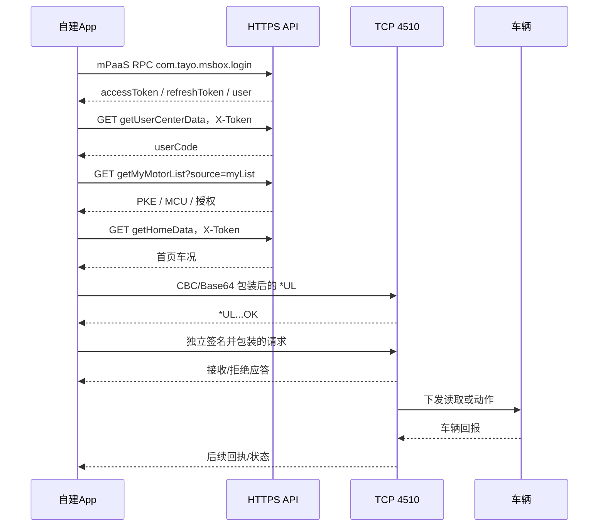

# 远端控车协议：官方 Android 1.59

更新日期：2026-10-30。以官方 `com.tayo.msbox` **1.59 / 4825** 为当前依据，旧版说明[另行归档](history/远端控车协议-旧样本.md)。旧文本兼容通道、第三方 ShiRide RSA 密钥和 iOS 1.66 的时间块都不用于当前实现。

**新版签名、四套 CBC 参数、TCP 认证与签名只读刷新已经验证；寻车、锁车、解锁的实际车辆动作仍待车主验收。** 本轮按授权仅登录和读取，没有发送车辆动作。

## 1. 样本与可复核资料

| 项目 | 值 |
|---|---|
| 包名 / versionName / versionCode | `com.tayo.msbox` / `1.59` / `4825` |
| APK SHA-256 | `b2660f08e463c0581083ea5556142bc7a14f5306b67665098859e4cb6ea6874e` |
| 发布者证书 SHA-256 | `b5292bf4ca492326f07597e2676b58e1587bc7195758348f9b6f23888c9c171c` |
| 真实性 | 完整签名校验通过，与已有原厂 APK 发布者一致 |
| 方法 | 隔离 Android 实例加载原 APK，运行时恢复；原 APK 未改写 |

加固 APK 中的初始占位方法可能为空或返回 null，不能当成完整实现。14 个恢复的业务 DEX 校验有效。当前路径由真实调用、出站 TCP 数据和服务端应答核对。

配套：[分析记录](../evidence/official-1.59-analysis.json)、[AES 参数](../resources/remote-159.json)、[合成固定向量](../vectors/remote-159.json)、[独立离线实现](../examples/remote159.py)。仓库不包含原 APK/SO/DEX、真实账号、Token、车辆材料、UUID/UTDID 或原始抓包。

## 2. 两条连接与完整顺序

| 通道 | 地址 | 用途 |
|---|---|---|
| HTTPS | `https://tbox.zontesmotor.com/zontespkeapp/api` | 登录、用户中心、车辆列表、首页、授权 |
| TCP | `www.sharpon.com:4510` | 设备认证、签名请求、回执 |



本轮已验证认证和 `*RE` 只读服务端应答。图中实际车辆动作的最后阶段尚待实车验收。

## 3. 登录、恢复与登录后处理

### 登录入口和响应

当前 APK 实际走 `POST https://mgw.mpaas.cn-hangzhou.aliyuncs.com/mgw.htm`，头部 `Operation-Type: com.tayo.msbox.login`，`Content-Type: application/json`。请求正文为数组：

```json
[{"_requestBody":{"brand":"升仕","grant_type":"password","lang":"CH","password":"<PASSWORD>","sys":209,"usercode":"<ACCOUNT>"}}]
```

这里的 password 是 TLS 内的原始密码，不是 MD5。原 APK 真实登录成功；把同一表单直接提交到 REST `/auth/oauth2/token` 已复现 HTTP 400、业务 `code=4000`、`msg=非法请求`，不能继续沿用该入口作为新登录实现。

网关需要正确的 AppId、WorkspaceId、productId、Platform、Version、Did、x-request-deviceid、x-app-sys-Id 等 RPC 头，以及 `Ts`、`Sign`、`signType`。这些头部应由匹配应用配置的 SDK 生成，不要将原版设备标识或捕获到的签名写死。原请求 `Ts` 为 7 字符编码时间，`Sign` 为 32 字符小写 hex，`signType=0`。

当前原版签名调用链已恢复：`a.tsa.n → a.zsa.f → a.dcb.l → a.tk2.c → a.s77.l → a.sk2`，使用 BlueShield/APSE 安全模块。对已捕获请求在本机调用原 SDK 签名函数，输出与真实 Sign 相同。普通 `MD5(body)` 或直接对三个字段拼接做 MD5 都不等价。

不带 Sign 的请求返回 HTTP 200、空正文、`Result-Status=7014`；不能将 HTTP 200 当成功。带签名但缺少业务所需 RPC 头时，也观察到 HTTP 200、`Result-Status=6666` 和业务 `code=4000`。使用完整原版 RPC 头和签名后，Mac 取得 `Result-Status=1000`、业务 `code=200` 和有效 Token。该测试使用授权登录请求，未执行车辆动作。

成功响应根字段为 `msg/code/data`，`data` 包含 `accessToken`、`refreshToken`、`user`。必须同时检查网关状态与业务状态。

### 原生签名实现（已独立验证）

当前样本的 BlueShield 算法 97 可以独立复现。令 `B` 为最终发送的 UTF-8 JSON 正文字节，`K` 为应用签名配置中的 32 字节字符串，`T` 为编码后的时间：

```text
C = "Operation-Type=" + operation
  + "&Request-Data=" + STANDARD_BASE64(B)
  + "&Ts=" + T
Sign = LOWERCASE_HEX(MD5(UTF8(K + "&" + C)))
```

`K` 按字符串 UTF-8 参与计算，即使外观看起来像十六进制，也**不能**先 HEX_DECODE。大小写、三个字段名中的连字符、两个分隔符 `&`、Base64 的 `+ / =` 都必须保留；这里不做 URL 编码。必须对最终发送的正文字节签名，不能签完后再改变空格、字段顺序或 Unicode/斜杠编码。

`T` 是 Unix 毫秒整数的 64 进制表示，字符表顺序为：

```text
0123456789ABCDEFGHIJKLMNOPQRSTUVWXYZabcdefghijklmnopqrstuvwxyz+/
```

这是整数进制转换，不是将十进制时间字符串做 Base64。当前日期得到 7 个字符；不要把 7 写死。算法与四条原版真实请求的 Sign 完全一致；另用合成密钥调用原 SDK 原函数验证了[固定向量](../vectors/mpaas-rpc.json)。可直接运行[独立请求构造器](../examples/mpaas_rpc.py)。

设备头使用稳定的安装标识。本项目通过 `Base64(SHA256(deviceUUID UTF8)[0:18])` 得到 `x-request-deviceid`，`Did` 为 `TEMP-` 加该标签；每次调用生成新 `Ts/Sign/TRACEID`，`RpcId` 使用当前请求编号。本项目请求编号取 `1`、配合新时间与随机 TRACEID，已完成当前网关验证。`AppId/WorkspaceId/productId/Platform/Version/x-app-sys-Id` 来自匹配应用的授权配置，不能使用示例中的占位值调用真实服务。

公开向量只包含合成密钥和合成账号。实际应用签名配置保存在私有应用资源中；账号密码、Token 和共享应用密钥不进入公开文档或日志。原生实现无需依赖运行中的安卓实例，也无需引入 mPaaS SDK。需要 SDK 接入时仍应使用匹配项目的配置，参考[官方 SDK 文档](https://help.aliyun.com/en/document_detail/111982.html)。

已使用 App 的实际 Swift 实现，在 Mac 完成真实登录、刷新 Token、用户中心、车辆列表和首页读取；不是只重放旧请求或只运行算法向量。iOS **1.2.7（30）已安装并启动**，手机端实际交互由车主验收。

### 已实测的登录后读取

以下均为 GET，头部 `X-Token: <accessToken>`。使用本轮官方 1.59 登录取得的 Token，三个接口均返回 HTTP 200、业务 `code=200`。

| 路径 | data 类型和关键内容 |
|---|---|
| `/pkeapp/gx/pke/carData/getUserCenterData` | 对象：userCode、nickName、avatarPath、userType、pkeCode、车辆数量 |
| `/pkeapp/motor/getMyMotorList?source=myList` | 数组：提取当前车辆 PKECode、MCUID、CarCode、授权；字段大小写按实际 JSON 映射 |
| `/pkeapp/gx/pke/carData/getHomeData` | 对象：myCarData、carLocation、imgPath、freezingMode、chaseMode、isAuthUser、isMyPke 等 |

处理顺序和边界：

1. 登录后以用户中心的 `userCode` 为 TCP 身份；不要使用手机号或 JWT 中的登录账号替代。
2. 安全保存 Token、刷新凭据和安装设备 ID。恢复登录先读取核心车辆信息，无关轨迹请求不要阻塞车辆页。
3. 刷新使用相同 RPC 操作 `com.tayo.msbox.login`，正文 `_requestBody` 含 `grant_type=refresh_token`、`refresh_token`、`sys=209`（数值）、`lang=CH`、`brand=升仕`。这一路径已真实返回新 accessToken/refreshToken，并用新 Token 读取车辆成功；无需再试历史字段 `refreshToken`。
4. 仅在 HTTP 401/403 或明确业务凭据失效时刷新/重新登录；网络超时不是密码错误。
5. 切车时整体替换 PKE、MCU、授权上下文，禁止混用两辆车的数据。Token 更新不能把账号手机号覆盖到已核对的 userCode。
6. 新版还存在 `/pkeapp/gx/pke/loginInfo/isDifferentDevice` 和 `/pkeapp/gx/pke/carData/getAuthMenuList`；其请求体、是否必经、全部返回含义尚未逐项复核，不能虚构绑定流程。
7. 当前控车路径不使用旧 RSA 公钥轮换服务，也没有认证失败后换旧通道的 fallback。

## 4. 四种身份不能混淆

| 字段 | 来源 | 用途 |
|---|---|---|
| UserCode | 用户中心 `userCode` | 认证身份和用户签名种子 |
| device UUID | 安装设备 UUID | `*UL` 第 3 字段 |
| PKECode / MCUID | 当前车辆资料 | 命令目标 / 32 hex 字符的 16 字节签名种子 |
| UTDID | `com.ta.utdid2.device.UTDevice.getUtdid(Context)` | 外层附加设备字段 |

UTDID 来源经 `SocketService → socket.s.o(ByteBuffer)` 的真实 JNI 调用确认。它是设备标识，不是账号密码、accessToken 或固定公钥。不要发布或复制真实车主 UTDID。

跨平台实现可使用持久的独立设备标签。本项目采用 `Base64(SHA256(deviceUUID UTF8)[0:18])`，得到 24 字符、无填充的标准 Base64。**这不是原 SDK 的 UTDID 生成算法**；该替代标识已通过当前服务认证和签名只读请求。它不替代 `*UL` 中单独的 device UUID。

## 5. 当前签名算法

真实函数：`com.tayo.msbox.utils.d3.f(String)`。用户种子从 UserCode 仅提取 ASCII `0..9`，取前 32 字符，右侧补 `0` 到 32 字符。车辆请求种子为 MCUID。

nonce `R` 每次独立生成 **8 个十进制数字字符**，但在混合密钥时按 **十六进制** 解析：`12345678` 对应 `12 34 56 78`。不能改成十进制整数或 8 个 ASCII 字节。

时间 `T` 是北京时间 `yyyyMMddHHmmss` 的 14 个 ASCII 数字，再追加两个 NUL 字节。不是字符串 `00`，也不是 16 个数字字符。

```text
K0 = W(HEX_DECODE(seed))
K = copy(K0)
K[12:16] ^= HEX_DECODE(R)
timeBlock = ASCII(T) || 00 00
H = LOWERCASE_HEX(AES-128-ECB-NoPadding(K, timeBlock))
N = CBC_BASE64("nonce", ASCII(R))
G = CBC_BASE64("signature", ASCII(H))
result = N || "," || G
```

`W` 与现有白盒查表相同，这是通过 **1.59 运行时 AES 的输入、密钥、输出重新核对** 的结论。也可直接用[参数文件](../resources/remote-159.json)中的 `seed_key` 做标准 AES-ECB。`H` 为小写 32 字符；CBC 加密这 32 个 ASCII 字节，不是原始 16 字节密文。

`N` 长 24 字符，`G` 长 64 字符。原 APK 签名函数对合成输入的结果已与离线向量逐字节相同。

## 6. 四套 CBC 参数

[remote-159.json](../resources/remote-159.json) 的 `wrapping` 包含 `nonce/signature/device/packet` 四套不同 key/IV。这些是 APK 中恢复的静态协议常量，不是用户凭据。

```text
key = HEX_DECODE(32字符key)      # 16字节，不是32字节ASCII
iv  = HEX_DECODE(32字符iv)       # 16字节
cipher = AES-128-CBC(key, iv, PKCS#7(plaintext, 16))
result = STANDARD_BASE64(cipher) # + / = 字母表，无换行
```

独立复算了原 APK 的 8 次 CBC 调用，全部一致。加固库传入的 360 字符 key token 不能直接作为 AES key；参数文件提供的是恢复后、经过标准 AES 复算验证的 16 字节 key。

## 7. 认证包及 TCP 外层

认证内层文本：

```text
*UL,<UserCode>,<deviceUUID>,0.0,0.0,<N>,<G>,1.59#
```

`N/G` 使用用户种子。`0.0,0.0` 是隔离环境原 APK 实际生成的经纬度字段。该内层文本已有结尾 `#`。

`com.tayo.msbox.socket.s.o(ByteBuffer)` 再执行：

```text
D = CBC_BASE64("device", ASCII(UTDID或独立标签))
P = innerText || "," || D
wire = ASCII(CBC_BASE64("packet", ASCII(P)))
```

设备字段追加在内层整个文本之后，所以认证形如 `...1.59#,<D>`，`#` 在该逗号前。TCP 最终发送 Base64 ASCII，不能直接发 `*UL`，也不能发旧 RSA 二进制。不要补 `#`、换行或 NUL。

本轮原账号样本：158 字节内层 → 203 字节附加设备字段后文本 → 280 字节外层。长度依赖真实字段，不能写死 280。

## 8. 车辆请求与实测边界

已验证的只读请求内层：

```text
*RE,<UserCode>,<PKECode>,<N>,<G>
```

`N/G` 使用当前车辆 MCUID，与认证独立生成 nonce/时间。该只读内层没有 `#`。按第 7 节包装后，当前服务返回结构化 `*RE,...,OK#`，还观察到后续 `*AM`。这不能当成已取得完整实时车况；它确认了当前签名请求得到服务端应答。

当前移植的动作布局：

| 动作 | 内层布局 | 验证状态 |
|---|---|---|
| 寻车 | `*UF,<UserCode>,<PKECode>,<N>,<G>` | 新版前缀/共享签名已确认，动作布局已移植，物理执行待验收 |
| 锁车 | `*ULoc,<UserCode>,<PKECode>,<N>,<G>` | 同上 |
| 解锁 | `*UClear,<UserCode>,<PKECode>,<N>,<G>` | 同上 |

诊断、冻结、追踪等扩展命令的完整新版参数、授权、终止符和回执尚未逐项复核，当前公开示例不开放这些扩展。不能直接把历史文档中的额外数字参数升级成当前规范。

## 9. 应答、分帧、超时

服务器应答为明文 ASCII，按 `#` 分帧；维护跨 receive 的缓冲，处理半帧和粘包，仅解析完整帧并限制总长度。

| 应答 | 当前证据支持的处理 |
|---|---|
| `*UL,...,OK#` | 认证报文的服务端回显/接收结果 |
| `*BR,1#` | TCP 认证成功，可发送下一请求 |
| `*BR,0#` / 明确拒绝 | 终止本次连接，不发送动作 |
| `*RE,...,OK#` | 当前签名只读请求的结构化应答 |
| `*AM,...#` | 观察到后续帧，未核对的字段不能虚构全部含义 |
| 裸 `,OK#` / 成功 socket write | 不足以证明签名或车辆执行成功 |

匹配命令类型、当前连接及可以取得的目标字段。未知结果不应凭空更新车辆锁状态。一次用户动作只发送一次；超时不得自动重发、换旧版本、换旧 RSA 密钥或切 BLE。应区分“服务器已接收”和“车辆已确认执行”。

## 10. 离线移植和验收顺序

在仓库根目录执行，示例不联网：

```python
import sys
sys.path.insert(0, "examples")
from remote159 import build_packets
p = build_packets("refresh", "USER123", "DEVICE123",
                  "00112233445566778899aabbccddeeff", "PKE123",
                  auth_nonce="12345678", auth_time="20261030123456",
                  command_nonce="87654321", command_time="20261030123457")
assert len(p.authentication) > 0
assert not p.authentication.startswith(b"*UL,")
```

任何语言先匹配[固定向量](../vectors/remote-159.json)的内层、两个签名字段和外层字节，再用自己的账号做只读验证。iOS 可用 CommonCrypto；Python 示例用 PyCryptodome。

已完成：原 APK 合成签名一致；8 次 CBC 复算一致；实际 Swift 构包/TCP 客户端在 Mac 接收器逐字节匹配向量并处理分片；同一 Swift 代码连接当前服务完成认证和只读应答；登录 400 的两个回归测试先复现失败，再由相同 Swift 实现通过；实际登录和 Token 刷新成功。iOS 1.2.7（30）已安装启动；完整回归 100 项中 98 项通过、2 项环境测试跳过。**手机交互与实际寻车/锁车/解锁仍由车主后续验收。**
