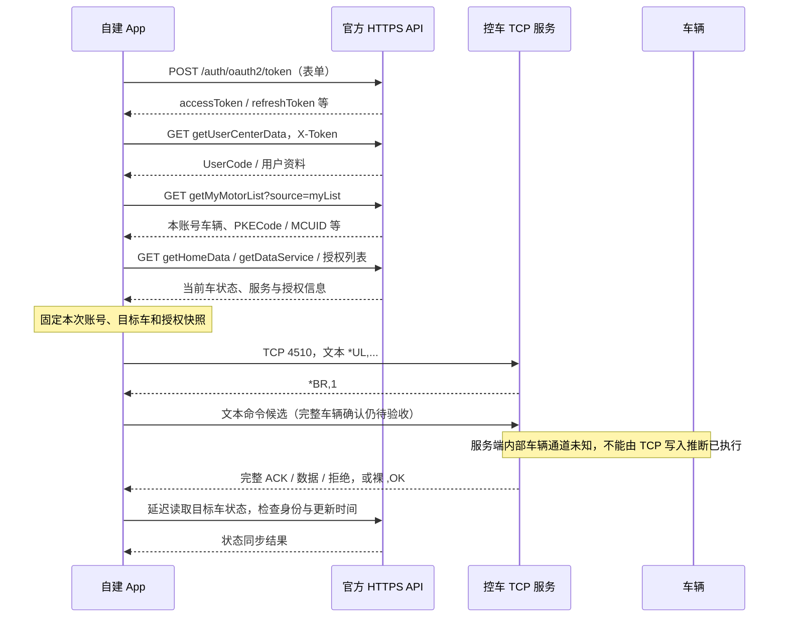
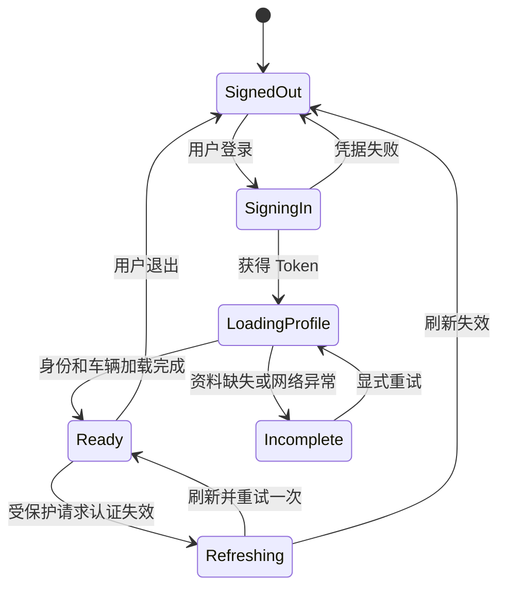

# 远端控车协议：登录、会话、车辆数据与 TCP 指令

版本：1.1 · 核对日期：2026-10-30。

本文面向独立开发 Android / iOS / 桌面 App 的开发者，说明从自己的升仕账号登录到远程控车的完整客户端链路。另一份文档是[蓝牙控车协议](蓝牙控车协议.md)。

## 1. 证据与适用范围

本文依据骑仕 ShiRide 1.2.25、1.3.0 的实际调用、`libc9x.so` ARM64 函数，以及 ZontesRide 原生 iOS 实现交叉整理。骑仕是协议观察样本，不能将其自建服务等同于升仕官方服务。

| 标记 | 含义 |
|---|---|
| 代码确认 | 源码/反编译调用能直接确认的请求、字段、算法或分支 |
| Native 确认 | 本次直接离线运行原始 SO 的协议函数，与独立实现逐字节相同 |
| 实现建议 | 为新 App 设计的处理规则，不宣称是服务器强制要求 |
| 待实测 | 服务器响应细节、车辆执行结果或不同车型支持尚无充分证据 |

最初整理仅做离线核对。后续在 Mac 使用已授权账号完成官方登录、用户资料及一台自有车辆材料读取，并进行有限 TCP 联调：两版 RSA 认证均无响应；文本认证收到 `*BR,1#`；只读刷新收到裸 `,OK#`；一次寻车已发送但缺少完整车辆确认，车主暂时无法观察车辆。**线上认证有响应不等于寻车成功**，更不能推出全部9种动作可用。脱敏记录见 [wire-verification.json](../evidence/wire-verification.json)。HTTP JSON 和带示例身份的 ACK 均为合成示例，公开内容不包含真实账号、Token 或车辆材料。

本次验证：1.3.0 的 9 种命令、18 条明文和 18 个 RSA 密文与原始 ARM64 一致；蓝牙另有 96 组输入分别对照两个版本。结果见 [native-verification.json](../evidence/native-verification.json)，样本指纹和源文件定位见 [source-index.json](../evidence/source-index.json)。

## 2. 三条通道与身份模型

| 通道 | 地址/服务 | 用途 | 身份材料 |
|---|---|---|---|
| 官方新版 HTTPS | `https://www.ifino.com:8081/zontespkeapp/api` | 登录、资料、车辆列表、状态、授权、轨迹 | `X-Token` |
| 官方旧版 HTTPS | `https://m.zontes.com/BoxApp` | H5/旧版兼容 | `ACCESSTOKEN` 参数、Cookie |
| 远程控车 TCP | `www.sharpon.com:4510` | 认证、发送车辆命令 | UserCode、deviceID、MCUID、PKECode；Native 另含 RSA 封装 |

普通 TCP 通道不是 HTTP，也没有在所分析路径中使用 TLS。新版 HTTPS 的 8081 端口不能遗漏；APK 网络封装会把两个 ifino API 基址的默认 443 改为 8081。该端口与仪表局域网 OTA 的 8081 不是同一个协议。

以下标识必须分别保存：

| 名称 | 真实用途 | 不能拿来代替它的值 |
|---|---|---|
| 登录账号 / 请求 `usercode` | 用户输入的登录名 | 控车的 UserCode 不一定等于它 |
| 官方 `UserCode` | 云端资料确认的用户身份；用于 TCP 认证 | 手机号、显示昵称 |
| `accessToken` | 官方 HTTP 会话凭据 | UserCode、骑仕 JWT |
| `refreshToken` | 更新官方 accessToken | accessToken、SignCode |
| `SignCode` | 旧 H5 自动登录凭据/资料兼容字段 | RSA 公钥、用户原始密码 |
| `deviceID` | 手机安装/客户端设备身份，进入 `*UL` | VIN、MCUID、蓝牙 MAC |
| `PKECode` | 目标车辆控车代码 | 列表 ID、任意另一台车的代码 |
| `MCUID` | 车辆对应的 16 字节十六进制认证材料 | IMSI、VIN；也不能与另一台车混用 |
| `CarCode` | 状态/历史轨迹等业务接口的车辆代码 | 默认不等于 PKECode |
| `CarNumber` / `ID` | 车辆列表与授权业务中的记录 ID | TCP 目标代码 |
| `IMSI` | 某些旧客户端目标回退链中的字段 | 新 App 不宜据此推断目标车 |

建议会话模型：`{generation, account, userCode, accessToken, refreshToken?, tokenTime?, signCode?, deviceID}`；车辆模型：`{id, pkeCode, carCode?, mcuid, ownership?, authorizationExpiresAt?, state}`。真实 MCUID 和 Token 不应写入公开日志或提交到代码仓库。

## 3. 从首次启动到控车的完整流程



Token 成功返回只完成了第一步。必须建立可信 UserCode、读取目标车材料、处理授权与会话更新，再允许构造控车上下文。TCP 报文没有直接携带 HTTP accessToken；HTTP 登录失效也不能仅凭 TCP 仍可能响应就继续展示账号已登录。

## 4. HTTP 约定

### 4.1 通用请求头

```http
Accept: application/json, text/plain, */*
User-Agent: okhttp/4.9.3
X-Token: <本账号官方 accessToken>
```

登录请求不加 `X-Token`。表单请求使用 `application/x-www-form-urlencoded; charset=UTF-8`；JSON 请求使用 `application/json; charset=utf-8`。空 POST 与 JSON `{}` 不相同。

表单键值先按 UTF-8 编码再做百分号编码。空格使用 `+` 或 `%20` 的等价表单表示，保留字 `& = + % #` 必须编码；密码不要先整串拼接后统一编码。数组、JSON 和路径段不能套用同一编码器。

### 4.2 响应处理顺序

1. 检查网络/HTTP 状态和 Content-Type；HTML 错误页不能按登录成功处理。
2. 解析 JSON。若存在有效 `data` 对象，业务解析从它开始；同时保留根层错误字段。
3. 检查业务错误，再读取 token/资料。HTTP 200 不代表业务成功。
4. 字段缺失、JSON null、字符串 `"null"`、空字符串分别按接口语义处理；不能直接构造假的用户/车辆 ID。

APK 兼容判断包含：`code` 为空或 `0` / `200` / `success` 可继续，`result=fail/false` 失败；`code=401`、`4000`、`isLogin=false`，或“令牌无效 / 登录已失效 / 请重新登录”等提示会触发登录失效。iOS 封装还将 HTTP 401/403 归为认证错误。不同接口可能含更多业务码，本仓库没有完整服务端错误码表。

`4000` 及账号/密码相关提示也参与密码兼容重试判定，不能把所有 `4000` 都解释为同一种业务原因。

## 5. 账号密码登录

### 5.1 请求

```http
POST /zontespkeapp/api/auth/oauth2/token HTTP/1.1
Host: www.ifino.com:8081
Content-Type: application/x-www-form-urlencoded; charset=UTF-8
Accept: application/json, text/plain, */*
User-Agent: okhttp/4.9.3

password=<编码后的输入>&grant_type=password&sys=209&lang=CH&usercode=<编码后的账号>&brand=%E5%8D%87%E4%BB%95
```

| 字段 | 类型/发送值 | 说明 |
|---|---|---|
| `password` | 字符串 | 首次使用输入密码；不是统一加盐 MD5 |
| `grant_type` | `password` | 固定 |
| `sys` | `209` | 固定协议值，含义未进一步确认 |
| `lang` | `CH` | 观察到的中文路径 |
| `usercode` | 字符串 | 输入登录账号，大小写按用户输入 |
| `brand` | `升仕` | UTF-8 表单编码 |

兼容流程：先用输入密码登录；仅识别为凭据错误且输入不是 32 位十六进制串时，再尝试 `lowerHex(MD5(UTF8(password)))`。已有 32 位十六进制输入不应再次 MD5；APK 的兼容准备步骤会保留其小写形式。网络超时、DNS 失败、HTTP 5xx 不应触发改密码算法重试。

### 5.2 响应候选

```json
{
  "code": 0,
  "data": {
    "accessToken": "<OWN_ACCESS_TOKEN>",
    "refreshToken": "<OWN_REFRESH_TOKEN>",
    "tokenTime": "<SERVER_TOKEN_TIME>",
    "user": {"userCode": "<LOGIN_RESPONSE_ID>"}
  }
}
```

这是用于理解层级的合成结构。客户端兼容 `accessToken/access_token`、`refreshToken/refresh_token`，iOS 另兼容 `token`。不能据此推断 JWT、过期时间、Token 可跨账号共享或三端互换。未确认固定的 token 寿命；缺失 tokenTime 时客户端可记录当前 Unix 毫秒，但不能把该本地时间当服务端有效期。

### 5.3 登录后必须补资料

```http
GET /zontespkeapp/api/pkeapp/gx/pke/carData/getUserCenterData
X-Token: <OWN_ACCESS_TOKEN>
```

读取官方资料中 `UserCode/userCode`，兼容 `UserID/userID`。旧归一化结构是 `UserInfo[0]`，新版可能包在 `data`。优先使用资料返回的官方 UserCode，Token 响应里的 `usercode` 可能只是输入登录名。缺少可靠身份时应显示“登录成功，但资料不完整”，不能把手机号填进 UserCode 后继续控车。

ZontesRide 兼容读取 `officialDeviceIdOverride` 或 `cloudsync.deviceId`，否则使用持久化安装 UUID。这些是实现兼容候选，不是已经证实官方接口一定返回的字段；不要为拿到 override 强制接入骑仕云同步。APK Android 默认 deviceID 来自 android_id、Build.SERIAL 与 Java 字符串哈希构造的 UUID，iOS 无法逐字复用该设备来源。自有安装 UUID 是否满足所有服务端设备绑定限制仍待账号联调。

更新资料时也可保存 `SignCode`、昵称、头像等，但这些不是 TCP 外层 RSA 公钥。资料请求失败时，新登录不应被视为已经获得完整控车权限。

## 6. 登录后处理：车辆、当前车与状态

### 6.1 车辆列表

```http
GET /zontespkeapp/api/pkeapp/motor/getMyMotorList?source=myList
X-Token: <OWN_ACCESS_TOKEN>
```

兼容容器包括 `data` 下的列表、旧归一化 `MyMotor`，旧接口还有 JSON 字符串形式的数组。不要用任意递归命中的第一个数组代替明确的车辆列表。

```json
{
  "data": {
    "MyMotor": [
      {
        "ID": "EXAMPLE_RECORD",
        "PKECode": "PKE123",
        "CarCode": "EXAMPLE_CAR",
        "MCUID": "12345678901234567890123456789012",
        "ItemName": "示例车辆",
        "isAuth": "mine"
      }
    ]
  }
}
```

全部为合成数据；容器及字段组合不是成功抓包。

| 归一字段 | 代码读取的兼容候选 | 用途 |
|---|---|---|
| id | `ID/id/CarNumber/carNumber` | 列表身份、授权业务 |
| pkeCode | `PKECode/pkeCode/pkECode/pke_code` | 控车目标；某些旧分支回退 CarCode |
| carCode | `CarCode/carCode/carcode` | 查询和状态匹配 |
| mcuid | `MCUID/mcuid/McuID/mcuId` | 16 字节认证种子，必须 32 hex |
| name | `RemarkName/ItemName/CarName` 等 | 展示，不参与认证 |
| ownership | `isAuth/isMyPke/isCurrentPke` | 归属、授权、当前车；三个概念需分别建模 |
| authorizationExpiresAt | `AuthorizationExpiresAt/AuthEndTime/ExpireTime` 等 | 客户端过期门控，候选不代表每台车都有 |
| serviceValidUntil | `ServiceValidTime` 等 | 服务期限；不能无条件当作车辆授权期限 |
| frame/engine | `frameNumber/engineNumber` 等 | 展示；与 PKE/MCUID 不可替换 |

空列表是合法状态。缺少 MCUID 的车辆可以展示，但不能伪造认证材料；当前 iOS mapper 会直接过滤材料不完整的条目，新 App 可选择“可查看、不可控制”的更明确模型。

### 6.2 首页和数据服务

| 请求 | 参数 | 客户端用途 |
|---|---|---|
| GET `/pkeapp/gx/pke/carData/getHomeData` | 无额外目标参数 | 服务端当前车辆状态、位置等 |
| GET `/pkeapp/gx/pke/carData/getDataService` | 无额外目标参数 | 服务、期限及车辆附加信息 |
| GET `/pkeapp/gx/pke/carData/getUserCenterData` | 无额外目标参数 | 用户身份、资料 |

状态常见归一容器为 `myCarData`、`CarLocation`、根/`data` 的 `iState`。每次把状态合入列表前，以 PKECode、CarCode、记录 ID 核对目标。多车账号中无法匹配的首页快照应保留待确认，不应覆盖当前选中车。

### 6.3 切换车辆

```http
POST /zontespkeapp/api/pkeapp/motor/changeMotor
X-Token: <OWN_ACCESS_TOKEN>
Content-Type: application/x-www-form-urlencoded; charset=UTF-8

isAuth=mine&pkeCode=<ENCODED_SELECTED_PKE>
```

授权车辆使用 `isAuth=auth`。该请求改变服务端当前车辆上下文；`getHomeData` 不带 PKECode，不能认为 UI 切换了下拉框就已经切车成功。

APK 切车后最多读首页 6 次，前 5 次不匹配时分别等待 180、360、540、720、900 ms；匹配失败返回“车辆切换尚未同步”。这是客户端策略，不是服务端 SLA。新 App 可保留此有限轮询，并取消旧车辆上的未发送操作。

已有 ZontesRide 的本地选择与服务端切车流程并不完全相同，移植不能只复制本地 selectedVehicle。多车首页必须单独验证。

### 6.4 状态字段与单位

以下为所读客户端的转换，不作为所有车型的通用单位承诺：

| 原始字段 | 已有处理 | 不确定性/边界 |
|---|---|---|
| `iState` | `1` 在线、`0` 离线 | 缺失时部分实现用 GSMRSSI>0 推断，应标为推断 |
| `Lock` | `0` 为锁定；`1/2` 为解锁 | 不能直接套 bool("0")；字符串 true/false 的兼容来自实现 |
| `Oil` | 0..100 百分比 | 超界/空值为未知 |
| `Range` | 展示预计续航 km | 车型需实测 |
| `Voltage` | 无小数且值≥50 时 /10，如 `126`→12.6 | `12.6` 不再除以10 |
| `PressureFront/Rear` | 原值 ×2，已有实现显示 kPa | 缺失/负值不可置0 |
| `ODOMileages` | 首页实现直接使用；历史轨迹实现 /10 | 不同接口不能共用未经验证的缩放 |
| `GSMRSSI` | 非负信号值 | 不一定是手机式 dBm |
| `SatelliteNum` | 非负整数 | 卫星数，不等于定位精度 |
| `Latitude/Longitude` | 经纬范围检查 | 坐标系需实测，不由名称认定 GCJ02/WGS84 |
| `ChangeTime/UpdateTime` | ISO8601、Unix 秒/毫秒或 UTC+8 文本 | 状态新鲜度需要额外检查 |

同类还有 `Speed/SpeedAverage/TripMileage/TripMaxSpeed/TripTimes/RideTimes/OilAuse/MaintenanceMileage/ChaseMode`。已定位字段名，不代表它们的单位、枚举和值域已全部验证。未知值应保留 unknown，不能为显示完整而填0。

## 7. 登录后处理：授权

所有新版请求使用同一官方 `X-Token`：

| 方法 | 路径 | 请求体/说明 |
|---|---|---|
| GET | `/pkeapp/gx/pke/authorization/getList` | 当前授权和被授权列表 |
| GET | `/pkeapp/gx/pke/authorization/getAuthHistoryList/1/10` | 第1页，每页10条的已观察调用 |
| GET | `/pkeapp/gx/pke/authorization/getAuthorizedHistoryList/1/10` | 被授权历史 |
| POST | `/pkeapp/gx/pke/authorization/addAuthorization` | JSON，见下 |
| POST | `/pkeapp/gx/pke/authorization/cancelAuthorization/{id}` | 路径编码，空 body，JSON Content-Type |

```json
{
  "id": "<OWN_VEHICLE_RECORD_ID>",
  "byUserCode": "<RECIPIENT_ACCOUNT>",
  "startTime": "2026-10-30 12:00:00",
  "endTime": "2026-10-30 18:00:00",
  "numberPwd": "<USER_ENTERED_PASSWORD>"
}
```

`id` 能解析为整数时 APK 会转为整数；`numberPwd` 在新版 JSON 路径直接使用输入。不要把旧接口的 MD5 规则套进来。新增/取消授权不是登录后必须自动执行的步骤。

兼容列表名 `AuthorizationList`、`BeAuthorizationList`、`BeiAuthorizationList`；单项读取 `ID/ItemName/Name/Mobile/StartTime/EndTime/AuthStates`。`AuthStates=9` 在客户端触发状态标记，精确业务含义未在本次证明，勿凭猜测授予权限。

每次准备控制前检查目标仍属于本账号可控制列表、授权起止时间、MCUID/PKECode 对应关系。过期或撤销后取消待发送任务并清除相关授权缓存；本地 canControl=true 只是门控，最终权限仍由服务端和车辆判断。

## 8. Token 刷新、恢复启动、并发与退出

### 8.1 刷新请求

```http
POST /zontespkeapp/api/auth/oauth2/token
Content-Type: application/x-www-form-urlencoded; charset=UTF-8

refresh_token=<ENCODED_REFRESH_TOKEN>&grant_type=refresh_token&sys=209&lang=CH&brand=%E5%8D%87%E4%BB%95
```

先尝试字段 `refresh_token`；凭据错误/兼容的 HTTP400 情况下，已有实现再尝试 `refreshToken`。不要同时发两个刷新请求。服务器是否轮换/一次性消费 refreshToken、是否支持全部账号类型，需实测。

更新 accessToken，若返回新的 refreshToken 则一起替换。重新取用户资料，防止 Token 响应里的登录名覆盖已确认的 UserCode。资料临时不可用时保留同一账号此前可信 UserCode 和 deviceID，不回退到任意字段。

### 8.2 推荐的会话状态机



恢复启动先从 Keychain/Keystore 读取会话，在允许的网络条件下重新确认资料；离线恢复只表示有本地资料，不表示重新验证过授权。受保护的只读请求最多“刷新一次 + 重试一次”，避免死循环。

为每次登录建立 generation。刷新开始时捕获 generation 和旧会话，完成时执行 compare-and-swap；期间若退出或换账号，丢弃旧刷新结果。所有并发 401 合并为一次刷新。车辆请求也捕获账号和目标车快照，返回时二次核对。

退出时增加 generation，取消网络/控车待发送任务、断开蓝牙、清除官方会话及 Cookie、取消轮询、清空用户车辆展示。保存不含身份的安装 UUID 可以用于下一次安装身份；不能复用上个账号的 MCUID 或 token。

## 9. 旧版与海外兼容

这一节是旧客户端与 2026-09-09 官方公开 JS 快照的兼容信息，未在本次重新验证线上旧登录有效性。新版 App 可先实现新版链路，再按账号需求增加旧版。

旧版地址 `/BoxApp/ashx/...`；海外模式将 `/BoxApp/` 换为 `/BoxApp/ABROAD/`，已带 ABROAD 时不重复插入。地区模式应由配置/账号决定，不因一次失败任意切区。

两种发送方式：

```http
POST /BoxApp/ashx/Index/Index.ashx?method=getIndex&ACCESSTOKEN=<TOKEN>
Content-Type: application/json; charset=utf-8
Cookie: ACCESS-TOKEN=<TOKEN>; TOKEN-STATUS=SUCCESS-TOKEN; IsLogin=True

```

上例 body 为0字节。另一种是表单 POST，带 `X-Requested-With: XMLHttpRequest`、`Origin: https://m.zontes.com`、页面对应 Referer、浏览器 UA；Cookie 合并服务端 Set-Cookie 与 ACCESS-TOKEN、TOKEN-STATUS、IsLogin、accessTokenTime。客户端构造 Cookie 不能代替有效服务端 token。

| ASHX | method | 额外参数/行为 |
|---|---|---|
| `UserCenter/UserInfo.ashx` | `nowlogin` | 登录，见下；注意不是 UserCenter.ashx |
| `UserCenter/UserCenter.ashx` | `getUserInfo` | URL参数+空POST |
| 同上 | `myMotorNew` | `source=myList`，表单优先，也有URL后备 |
| 同上 | `myMotor` | 车辆列表后备 |
| 同上 | `changeMotor` | `isAuth=mine/auth`、`pkecode`，小写名称 |
| 同上 | `motorRemarkName` | `remarkName,pkecode` |
| `Index/Index.ashx` | `getIndex/getNotice/checkTokenTime` | 最后一项带 tokenTime |
| `DataService/DataService.ashx` | `getDataService` | 表单 |
| `UserCenter/Authorization.ashx` | `getList/getAuthList` | 表单 |
| 同上 | `addAuth` | `id,bycode,startTime,endTime,mobile="",checkCode="",numberPwd` |
| 同上 | `cancleAuth` | `id`；保留接口原拼写 cancle |

公开 JS 快照登录：`method=nowlogin&logintype=SPLogin&name=<账号>&pwd=MD5(原始密码+staticSalt)`，当时静态盐为 `Tk9@#Auth2026!*`。这是旧 H5 规则，不用于新版 OAuth。自动登录分支 `logintype=autoLogin,name=UserCode,pwd=SignCode`。需获取并核对当前公开脚本后再用于新的线上兼容版本。

旧版返回可含 `accessToken,tokenTime,UserCode,SignCode,MyMotorCode,mcuid,imsi,isMyPke`。旧登录后的身份确认仍应读取资料与本账号车辆列表，不能仅信任网页桥传进来的任意 JSON。

骑仕 `api.shiride.com` 的 Bearer JWT、云同步、安装公钥、归档等属于其自建云服务，本协议的基本官方登录/控车无需向该服务上传账号或 token。

## 10. 远程命令输入和边界

Native 入口概念签名：

```text
q0(Context, commandId, UserCode, deviceID, MCUID, targetCode) -> [256 bytes, 256 bytes]
```

| 参数 | 约束 |
|---|---|
| UserCode | 1..32 个 ASCII 字节 |
| deviceID | 1..64 个 ASCII 字节 |
| targetCode | 1..64 个 ASCII 字节；新实现明确使用目标 PKECode |
| MCUID | 恰好32个大小写均可的十六进制字符，hex解码16字节 |

前三个字段限 `0x21..0x7e`，排除逗号和 `#`。不允许空格、中文、控制字符。不要静默截断或自动修正真实身份。

旧 APK 的 targetCode 后备顺序：目标 pkeCode → carCode → imsi → vehicleKey → 当前车 PKECode → CarCode → IMSI。它描述兼容实现，不应作为新 App 在多车情况下混搭字段的理由。

## 11. 内层认证：白盒、nonce 与 AES

### 11.1 随机数和时间

每个操作生成两个独立随机串 `R_auth/R_cmd`，各8个十进制 ASCII 数字，允许前导0。Native 每位来自 `arc4random_uniform(10)`；生产代码使用系统安全随机数，不使用时间戳或 Math.random 替代。

生成两个14位时间串 `T_auth/T_cmd=yyyyMMddHHmmss`。Native 为 `gmtime(time(NULL)+28800)`，即固定 UTC+8，与手机时区无关。原函数按认证随机数→认证时间→命令随机数→命令时间取值，可能跨秒；不要假设两个时间必须相同。服务端容许时差未知。

### 11.2 完整公式

```text
U = 只保留 UserCode 中 ASCII 0..9，取前32位，右补字符0至32位
K_auth = W(hexDecode(U))
K_cmd  = W(hexDecode(MCUID))

K_auth[12+i] ^= hexDecode(R_auth)[i]   i=0..3
K_cmd [12+i] ^= hexDecode(R_cmd )[i]   i=0..3

S_auth = upperHex(AES-128-ECB(key=K_auth, block=ASCII(T_auth)||00 00))
S_cmd  = upperHex(AES-128-ECB(key=K_cmd,  block=ASCII(T_cmd) ||00 00))
```

`12345678` 的 hexDecode 是字节 `12 34 56 78`，不是整数12345678的大小端转换。`W` 输入输出均16字节。时间块恰好16字节，末尾两个 `0x00`；**没有 IV，没有 CBC，没有 PKCS#7 填充，也不是 MD5/HMAC**。文中“签名”沿用客户端叫法，实际为 AES 密文块。

### 11.3 白盒查表的完整定义

[c9x_tables.bin](../resources/c9x_tables.bin) 是已解码的查表数据，长度 `0x5b000=372736`，SHA-256：

```text
58234bb81e68933db3f244003817a622c7a866c332bec8b5d6164e128d887d07
```

| 偏移 | 长度 | 用途 |
|---|---|---|
| 0x00000 | 0x24000 | 9×16×256×4字节替换表 |
| 0x24000 | 0x36000 | 9×16×6×256字节半字节合并表 |
| 0x5a000 | 0x01000 | 16×256字节末轮替换表 |

每轮取列的输入位置排列 `P=[0,5,10,15,4,9,14,3,8,13,2,7,12,1,6,11]`。9轮中，令轮 `r=0..8`，列 `c=0..3`，每个位置 p 的四字节表项偏移为 `((r*16+p)*256+state[p])*4`。按 P 的每4个位置取得4个 word。

对列内第 j 个输出字节，令四个 word 的第 j 字节为 a,b,c0,d；`base=0x24000+r*0x6000+(c*4+j)*0x600`：

```text
hab = table[base       + (a&0xf0) + (b>>4)]
hcd = table[base+0x100 + (c0&0xf0) + (d>>4)]
hi  = table[base+0x200 + (hab<<4) + hcd]
lab = table[base+0x300 + ((a&15)<<4) + (b&15)]
lcd = table[base+0x400 + ((c0&15)<<4) + (d&15)]
lo  = table[base+0x500 + (lab<<4) + lcd]
output[c*4+j] = (hi<<4)|lo
```

每轮 output 成为下一轮 state。末轮用 `F=[0,13,10,7,4,1,14,11,8,5,2,15,12,9,6,3]`：`result[F[i]]=table[0x5a000+i*256+state[i]]`。合并表不能直接换成 XOR；它已包含编码。可运行定义是 [whitebox_block()](../examples/protocol.py)。

1.2.25 原 SO 的三个表位于虚拟地址 `0xd890/0x31890/0x67890`，各用 seed `0x4dee9826/0x0e66acf8/0x404c7b4b` 解码：`decoded[i]=encoded[i] XOR low8(mix32(seed+i*0x9e3779b9))`。

```text
mix32(x):
  x &= 0xffffffff
  x = ((x^(x>>16))*0x7feb352d) & 0xffffffff
  x = ((x^(x>>15))*0x846ca68b) & 0xffffffff
  return x^(x>>16)
```

这些 SO 地址只适用于已记录的版本，不能在新版上盲用。本仓库直接附已验证的解码表；无需 Android、JNI、SO 或任何用户私钥即可实现编码。表本身不能替代正确的账号和车辆材料。

## 12. 明文报文与全部远程命令

认证明文：

```text
*UL,{UserCode},{deviceID},0.0,0.0,{R_auth},{S_auth},1.56#
```

两个 `0.0` 和 `1.56` 是观察到的固定字符串，不能因手机 GPS/版本不同自动替换。大小写、逗号、`*`、`#` 均为协议字节，不附加换行/NUL。

| ID | 操作 | 命令明文 | 末尾# |
|---:|---|---|---|
| 0 | 上锁 | `*ULoc,{U},{P},{R},{S}` | 无 |
| 1 | 解锁 | `*UClear,{U},{P},{R},{S}` | 无 |
| 2 | 寻车 | `*UF,{U},{P},{R},{S}` | 无 |
| 3 | 刷新车辆信息 | `*RE,{U},{P},{R},{S}` | 无 |
| 4 | 诊断 | `*UKEY,{U},{P},3,{R},{S}` | 无 |
| 5 | 冻结 | `*UFreeze,{U},{P},1,{R},{S}#` | 有 |
| 6 | 解冻 | `*UFreeze,{U},{P},0,{R},{S}#` | 有 |
| 7 | 开启追踪 | `*UChase,{U},{P},1,{R},{S}#` | 有 |
| 8 | 关闭追踪 | `*UChase,{U},{P},0,{R},{S}#` | 有 |

U=UserCode，P=目标PKECode，R/S=命令nonce及签名。表中是 **RSA 加密前的 Native 原文**；前5种原文没有终止 `#` 已由两个版本 Native 验证，复现 Native 向量时不可补齐。独立文本候选实现 `build_text_frames()` 会补成一个 `#`，与 Native 原文分别保留。线上只读刷新有/无此终止符都仅返回裸 `,OK#`，因此尚不能认定命令阶段的正确格式已经证实。冻结不等同于上锁，追踪不等同于蓝牙连接；车型上的具体执行语义尚需车辆验证。

## 13. Native 外层 RSA 与公钥版本（线上可用性未证实）

APK Native 将认证和命令分别用 **RSA-2048 / RSAES-PKCS1-v1_5** 加密，指数65537。该事实不能直接推断当前 TCP 服务接受这些包；本次两版公钥的认证包均未收到应答，切换公钥没有修复超时。

```text
EM = 00 02 || PS || 00 || plaintext
len(EM)=256
len(PS)=253-len(plaintext)，PS每个字节必须非零，至少8字节
ciphertext=I2OSP(OS2IP(EM)^65537 mod N,256)
```

明文限1..245字节，输出固定256字节、大端。生产调用系统 RSA PKCS#1 v1.5 加密接口并启用新随机填充。禁止使用 OAEP、签名接口、NoPadding 直接包明文或固定测试PS。相同明文每次密文不同是正常结果。

| 样本版本 | PEM资源 | 对应SPKI DER SHA-256 |
|---|---|---|
| 1.2.25 | [旧公钥](../resources/remote-rsa-shiride-1.2.25.pem) | `55ff3f80ced07f771ddb2b3c8880b1763b03f56deb0dc885968cc1e730e903b2` |
| 1.3.0 | [新公钥](../resources/remote-rsa-shiride-1.3.0.pem) | `1387b90a10cf6b55fd86a2f614c46e4e67ba3154be4f38cdddb02bdd5d01d19f` |

指纹针对294字节 SPKI DER，不是带换行的 PEM 文本。离线 RSA 示例默认1.3.0。1.3.0 原始函数的18个密文已与新公钥计算值逐字节比较；这只证明样本一致，不能证明服务端接受它。

App 自行生成的 SSH 公钥、固件 OTA 签名公钥、TLS 证书和控车 RSA 公钥都不是同一用途。**控车公钥必须与服务端使用的私钥配对，不能在手机上随意生成一把替换。**

ZontesRide 曾实现项目自有 HTTPS + Ed25519 签名清单，用来发布新的 RSA 公钥；它不是升仕官方密钥获取接口，也不能修复本次传输格式差异。修复版文本认证路径不依赖公钥轮换。默认清单 URL 为空。以下保留为该自建机制的格式说明，独立 App 无需为此搭建密钥服务。

该实现的签名载荷是 UTF-8 `version\nalgorithm\nkeyDER\nsha256\nnotBefore\nexpiresAt\n`，keyDER 为Base64，签名密钥由各 App 发布方自行持有。无需共享开发者的私钥来实现车辆协议。

## 14. TCP 交互、超时和重试边界

```text
CONNECT www.sharpon.com:4510
SEND ASCII *UL,...#         本次线上认证获得响应
READ 累积ASCII，等待完整 *BR,1#
SEND ASCII 命令候选          实车执行仍待验收
READ 按命令收集完整帧；裸 ,OK# / 回显不能当作车辆确认
CLOSE
```

以上为修复版文本路径，不使用 Base64/Hex、HTTP头或换行。APK 则按同样的两阶段顺序写两个256字节 Native RSA 包；该路径本次线上未得到认证响应。认证成功前不发命令；不能把两阶段报文直接拼接发送。Socket write/flush 成功只说明本地传输层接受了字节。

| 阶段 | 已观察客户端期限 |
|---|---:|
| DNS | APK约3秒 |
| TCP建立 | 最多5秒 |
| 认证响应 | 约2.2秒 |
| 普通命令响应 | 约3.2秒 |
| 诊断响应 | 约12秒 |
| 普通操作总期限 | 15秒 |
| 诊断总期限 | 25秒 |
| 单次读取等待 | APK最多约700ms |
| 响应累计上限 | 65536字节 |

期限是客户端策略；应使用单调时钟、包含 DNS 的总期限，并在断网/取消后关闭连接。连接、认证、命令各阶段应分别报告错误。

本次没有依据将自动换 RSA 公钥作为认证修复策略。认证成功且命令已提交之后，无论响应丢失、超时或断线，均视为结果未知，不能自动重发开锁、寻车、冻结等动作。只读状态查询与动作重试不是同一种操作。

## 15. 响应格式与正确判定

完整协议帧为 `*` 起始、逗号分隔、`#` 结束的 ASCII 文本，存在 TCP 拆包/合包。保留未完成尾部，连续提取完整帧，不假设 receive 一次就是一条。2026-10-30 线上还观察到孤立4字节 `,OK#`；它没有命令与车辆身份，不能视作车辆执行成功。命令原文回显也应排除，继续等待对应的完整应答；未收到则结果未知。

### 15.1 认证

已知成功帧 `*BR,1#`。认证ACK只用于解锁“可发命令”的阶段，不是车辆已经执行。其他认证值的完整枚举尚未还原；不能仅凭存在 `*BR,` 就当成功。

### 15.2 命令结果

| 命令 | APK 1.3.0 观察到的识别规则 |
|---|---|
| 上锁 | 完整 `*ULoc,...,OK#` |
| 解锁 | 完整 `*UClear,...,OK#` |
| 寻车 | `*UF,...,OK#` |
| 刷新 | `*RE,` 或数据响应可能被识别；不等同车辆已经刷新到最新 |
| 诊断 | `*AM,...,003,3,N,item...#` 或 `*UKEY,...,003,3,N,item...#`，要求 N=尾随项目数 |
| 冻结/解冻 | 相关 `*UFreeze,` 成功帧，或匹配操作码的 `*AC,...,009/010,1#` |
| 追踪开/关 | 相关 `*UChase,` 成功帧，或匹配操作码的 `*AC,...,007/008,1#` |

`*AC` 解析要求共5字段、两个中间身份字段非空、操作码匹配，尾值`0/1`；`0` 为拒绝，`1` 为确认。原客户端没有充分核对中间字段是否就是本次 UserCode/PKECode，因此本文不把中间字段的精确语义宣称为已确定。诊断项目的完整含义/单位没有确认，不按猜测解释为故障码。

APK原实现还在部分非锁车路径兼容 `*DM,...,OK#`；它可以是通用确认/数据路径，完整中间字段语义尚未确定。不能把任意 `*DM` 或孤立 `,OK#` 当作当前目标执行完成。

原客户端全局出现 `,FAIL#` 或相关 `*AC,...,0#` 时拒绝优先。错误命令的OK、无关心跳、旧连接ACK、只出现成功前缀都不能确认本次操作。TCP单次交易最好只允许一个命令，保留阶段和已发送状态。

现有 iOS 实现对部分非锁车命令的前缀判断较宽，且见到第一个 `#` 就结束一次读取；独立 App 不应原样继承。建议继续收集相关完整帧，直到明确拒绝/确认/截止时间。若目标或 nonce 未在 ACK 回显，就不能声称实现了强关联校验。

参考代码 `remote_ack()` 是保守的关联示范：仅在帧中的中间字段确实等于示例身份时判定，未知布局忽略。它不是服务端所有车型应答的完整兼容解析器。`received`、`confirmed`、最终车辆状态应是不同层次。

### 15.3 最终状态同步

锁/解锁 ACK 后重新读取车辆列表/首页，检查目标匹配、状态时间和锁状态。已有 iOS 在 ACK 后使用期望状态临时展示，再以1、2、3、5、8秒的逐次等待重新查询；这些是连续等待，非绝对时刻。新 App 应明确标“等待同步”，不能把临时覆盖的UI值当作已读取的真实车况。

寻车、油箱/坐垫和冻结等未必有可读最终状态字段。只收到了服务器ACK时，显示“命令已受理/车辆结果待确认”比无条件显示“已完成”更准确。

## 16. 可选的车辆资料和历史查询

| 功能 | 方法/路径 | 关键参数 |
|---|---|---|
| 修改备注 | POST `/pkeapp/gx/pke/carData/motorRemarkName` | 表单 `pkeCode,remarkName` |
| 新版历史 | GET `/pkeapp/hbaseLocation/selectByCarCodeHbase/{CarCode}` | `startTime,endTime` |
| 旧版历史 | POST `/BoxApp/ashx/Common/common.ashx` | 表单见下 |

新版时间 `yyyy-MM-dd HH:mm:ss`，按 Asia/Shanghai；路径段和查询值分别编码。旧版为 `method=getHistoryPathNew&CarCode=...&DateTimeStart=...&DateTimeEnd=...`，时间格式 `yyyy/MM/dd  HH:mm:ss`，中间**两个空格**，主要通过封装 Cookie 鉴权，body 未显式放 Token 不代表无需登录。

轨迹兼容字段 `CreateTime/createTime/time/gpsTime,Longitude,Latitude,Speed,ODOMileages,Lock`。旧APK单次7天、展示最多30000点、归档大于20000点时拆段是客户端限制，不是已确认的服务端配额。拆段注意边界重复、排序、时区和坐标系。

## 17. 独立实现与离线验收

```sh
python3 -m venv .venv
.venv/bin/pip install -r requirements.txt
.venv/bin/python -m unittest discover -s tests -v
.venv/bin/python examples/verify.py
```

```python
import sys
sys.path.insert(0, "examples")
from protocol import build_plaintexts, rsa_encrypt

plain = build_plaintexts(
    "lock", "USER123", "DEVICE123",
    "12345678901234567890123456789012", "PKE123",
    auth_nonce="12345678", auth_time="20260909123456",
    command_nonce="87654321", command_time="20260909123457",
)
assert plain.authentication.decode() == (
    "*UL,USER123,DEVICE123,0.0,0.0,12345678,"
    "90B1EB8DC232296CD11BBAABDE7895D6,1.56#"
)
assert plain.command.decode() == (
    "*ULoc,USER123,PKE123,87654321,823DE4E9E7E103A9C35BB382DD98BFFA"
)
auth_packet = rsa_encrypt(plain.authentication)  # 默认1.3.0公钥，随机填充
assert len(auth_packet) == 256
# 示例不连接服务器、不发送命令。
```

完整确定性 RSA 向量及PS在 [remote-1.2.25.json](../vectors/remote-1.2.25.json) 和 [remote-1.3.0.json](../vectors/remote-1.3.0.json)。固定nonce/时间/PS仅用于测试，生产必须重新生成。

移植时分别验证两层：离线资源SHA→白盒→nonce混入→AES签名→Native原文/RSA向量；线上自己的账号登录→资料/车辆材料→实际传输格式→分帧/状态机→只读联调→目标车辆结果确认。RSA 向量通过不能替代线上传输验证。Swift AES 可用 CommonCrypto ECB无padding；RSA 复现可用 Security `SecKeyCreateEncryptedData(...,.rsaEncryptionPKCS1,...)`。Android 对应 AES/ECB/NoPadding 与 RSA/ECB/PKCS1Padding。

当前仍待实测：服务端实时公钥接受范围、deviceID绑定策略、时钟容差、Token寿命、各车型/授权身份支持、完整ACK身份字段、诊断项目含义、状态单位和同步延迟。离线一致性不等于线上或实车验收完成。
